# Labs64.IO :: Docs

**The documentation for running, using and configuring Labs64.IO.**
*Part of the [Labs64.IO Ecosystem](https://labs64.io): the source of the documentation site at labs64.io/docs.*

[**Get started**](https://labs64.io/docs/getting-started/) · [Features](#features) · [AI agents](#using-it-with-ai-agents) · [Ecosystem](#the-labs64io-ecosystem) · [Documentation](https://labs64.io/docs/) · [labs64.io](https://labs64.io)

> [!NOTE]
> This repository owns technical reference and onboarding, not marketing. Module status and versions come from the website's `_data/modules.yml` and are never restated in pages.

## Why Docs?

Good documentation is read by people who are in the middle of something: trying to get a first request through, or deciding whether this is the right tool for the team. This site is organised around what they are doing.

1. **Get started.** A five-minute Quickstart and a comparison of every way to run Labs64.IO.
2. **Use a module.** One reference per module: capabilities, API, configuration, events, operations and troubleshooting.
3. **Change the code.** A contributor guide, the workspace layout and the OpenAPI-first workflow.

**A good fit if**

- You want to run, use or configure a Labs64.IO module and need the reference.
- You are evaluating the platform and want to compare the ways to run it.
- You found a page that is wrong or missing and want to fix it.

**Probably not what you need if**

- You are looking for marketing or positioning: that lives on [labs64.io](https://labs64.io).
- You want internal design records: those are in a private repository.

## Features

- **Adopter guides**: quickstart, one module, your own cluster, the whole ecosystem from source, troubleshooting.
- **Module references**: AuditFlow, Auth Gateway, Checkout, Payment Gateway and Customer Portal, each with capabilities, API, configuration and operations.
- **Contributor handbook**: build and test a module, the OpenAPI-first workflow, workspace layout.
- **Diagrams as code**: Mermaid in any page.
- **Machine-readable**: `llms.txt` and full-text exports for agents.
- **Docker-first**: preview, build and link-check without installing Ruby.

## Where things live

| You want… | Look in |
|---|---|
| The five-minute path | [`getting-started/quickstart.md`](getting-started/quickstart.md) |
| To choose how to run it | [`getting-started/`](getting-started/index.md) |
| A module's API, configuration and operations | [`modules/<module>/`](modules/index.md) |
| How it fits together | [`introduction/architecture.md`](introduction/architecture.md) |
| To change the code | [`development/contributing.md`](development/contributing.md) |

The published site is at [labs64.io/docs](https://labs64.io/docs/).

## Using it with AI agents

The docs are plain Markdown with an `llms.txt` index, so agents can read them too. The [guide for AI agents](https://labs64.io/docs/introduction/ai-agents.html) covers authentication, retries and errors across all modules. Working on this repository with an agent? [`AGENTS.md`](AGENTS.md) and [`CLAUDE.md`](CLAUDE.md) describe conventions and verification.

## The Labs64.IO Ecosystem

Docs is one module of the [Labs64.IO Ecosystem](https://labs64.io); [every module is documented here](https://labs64.io/docs/).

| Module | What it does | Link |
|---|---|---|
| **AuditFlow** | Audit-event routing pipeline | [labs64.io-auditflow](https://github.com/Labs64/labs64.io-auditflow) |
| **API Gateway** | Authenticating, policy-enforcing edge for all modules | [labs64.io-authproxy](https://github.com/Labs64/labs64.io-authproxy) |
| **Payment Gateway** | One API over multiple payment providers | [labs64.io-payment-gateway](https://github.com/Labs64/labs64.io-payment-gateway) |
| **Checkout** | Embeddable, brandable checkout | [labs64.io-checkout](https://github.com/Labs64/labs64.io-checkout) |
| **Customer Portal** | Customer self-service UI | [labs64.io-customer-portal](https://github.com/Labs64/labs64.io-customer-portal) |
| **Commons** | Shared Java and Python libraries | [labs64.io-commons](https://github.com/Labs64/labs64.io-commons) |
| **Helm Charts** | Kubernetes deployment for every module | [labs64.io-helm-charts](https://github.com/Labs64/labs64.io-helm-charts) |
| **Workspace** | Dev container and multi-repo tooling | [labs64.io-workspace](https://github.com/Labs64/labs64.io-workspace) |
| **Tests** | Cross-module regression suite | [labs64.io-tests](https://github.com/Labs64/labs64.io-tests) |
| **Docs** | Published documentation | [labs64.io-docs](https://github.com/Labs64/labs64.io-docs) |
| **NetLicensing** | Licensing-as-a-Service: license and entitlement management | [netlicensing.io](https://netlicensing.io) |
| **GuideChimp** | Interactive guided product tours | [labs64.com/guidechimp](https://www.labs64.com/guidechimp/) |

## Contributing

We would love your help. Found a typo, a stale command or a missing explanation? A one-line fix is a real contribution here. Fork the repository, make your change on a branch, run the checks described in [`AGENTS.md`](AGENTS.md) and open a pull request. Not sure whether an idea fits? Open an issue first and we will talk it through; that is a perfectly good way to start.

## License

Licensed under the [Apache License 2.0](LICENSE).

---

   
  Made by the <a href="https://labs64.io">Labs64</a> team and community.

