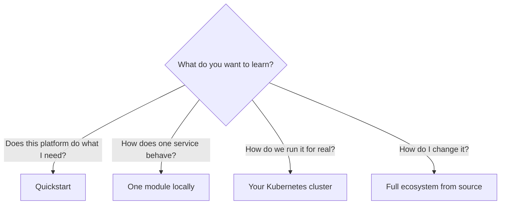

# Compare the Paths

Four ways to run Labs64.IO, side by side. If you just want a recommendation: start with the [Quickstart](./quickstart.md), and come back here when you need to decide what comes after it.

## At a glance

| | [Quickstart](./quickstart.md) | [One module](./run-one-module-locally.md) | [Your cluster](./deploy-to-kubernetes.md) | [Full ecosystem](./run-the-full-ecosystem-locally.md) |
|---|---|---|---|---|
| **For** | Evaluating | Exploring one service | A team or production | Contributing |
| **Runs on** | Any Kubernetes cluster | Docker Compose | Your Kubernetes cluster | A local k3d cluster |
| **Software comes from** | Published images and charts | Built from source | Published images and charts | Built from source |
| **Gateway and authentication** | Yes, with a demo identity provider | No | Yes, with your identity provider | Yes, with a mock identity provider or Keycloak |
| **Data stores** | Bundled, in the cluster | Bundled, in Compose | Yours, or bundled | Bundled, in the cluster |
| **Services included** | AuditFlow, Payment Gateway | AuditFlow | The ones you choose | All of them |
| **Time to first request** | About 5 minutes | A few minutes | An afternoon for a first environment | One long first build |
| **Safe to expose** | No | No | Yes, after the go-live checks | No |

## What each path needs on your machine

| Tool | Quickstart | One module | Your cluster | Full ecosystem |
|---|:---:|:---:|:---:|:---:|
| `kubectl` | ✓ | | ✓ | ✓ |
| Helm 4 | ✓ | | ✓ | ✓ |
| Docker | For a local cluster | ✓ | | ✓ |
| `just` | | ✓ | | ✓ |
| JDK 25 and Maven | | ✓ | | |
| k3d and Helmfile | | | | ✓ |

The full ecosystem builds images inside a container, so it needs no JDK or Node on your machine. Its dev container brings every tool in the last column.

## Which one, then?

A common sequence for a team adopting the platform:

1. One person runs the **Quickstart** on a laptop to see whether the platform fits.
2. The same person runs **one module** to learn its configuration in detail, usually AuditFlow and its pipelines.
3. The platform team installs it on **your cluster**, first with bundled data stores, then with managed ones.
4. Whoever needs a change the platform does not have yet sets up the **full ecosystem** and opens a pull request.

> **Local defaults are not production configuration.** The first, second and fourth path use well-known passwords and an identity provider that authenticates nobody. Only the cluster path, with the [go-live checks](./deploy-to-kubernetes.md#before-you-go-live) done, is meant to face other people.
