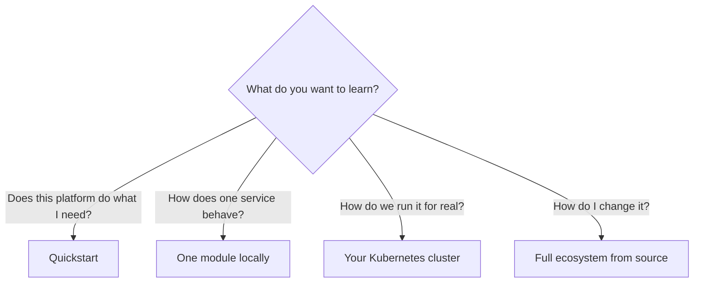

# Compare the Paths

Four ways to run Labs64.IO, side by side. If you just want a recommendation: start with the [Quickstart](./quickstart.md), and come back here when you need to decide what comes after it.

## Why Helm Charts?

Running a platform of several services means one chart per service, gateway wiring, an identity provider and a handful of backing stores, and you want to see it work before you commit a week to it. Helm Charts is how you start small and grow.

1. **One command to see it work.** `install.sh` installs the platform on any cluster and proves it with a real request.
2. **Cherry-pick modules.** Every module chart is standalone: install only what you need, and bring your own infrastructure.
3. **A path to production.** The same charts run on AWS, Azure, Google Cloud or on-premises, with a `preflight` chart to check your infrastructure first.

**A good fit if**

- You want Labs64.IO on a Kubernetes cluster, from a laptop to a managed cloud.
- You want to adopt one module at a time and bring your own database, broker and identity provider.
- You want a repeatable, scriptable install that can run unattended in CI.

**Probably not what you need if**

- You do not run Kubernetes: the Docker option in each module's README is the simpler way to evaluate a single service.
- You want a fully managed hosted offering: these charts are for running it yourself.

## At a glance

| | [Quickstart](./quickstart.md) | [One module](./run-one-module-locally.md) | [Your cluster](./deploy-to-kubernetes.md) | [Full ecosystem](./run-the-full-ecosystem-locally.md) |
|---|---|---|---|---|
| **For** | Evaluating | Exploring one service | A team or production | Contributing |
| **Runs on** | Any Kubernetes cluster | Docker Compose | Your Kubernetes cluster | A local k3d cluster |
| **Software comes from** | Published images and charts | Built from source | Published images and charts | Built from source |
| **Gateway and authentication** | Yes, with a demo identity provider | No | Yes, with your identity provider | Yes, with a mock identity provider or Keycloak |
| **Data stores** | Bundled, in the cluster | Bundled, in Compose | Yours, or bundled | Bundled, in the cluster |
| **Services included** | AuditFlow, Payment Gateway | AuditFlow | The ones you choose | All of them |
| **Time to first request** | About 5 minutes | A few minutes | An afternoon for a first environment | One long first build |
| **Safe to expose** | No | No | Yes, after the go-live checks | No |

## What each path needs on your machine

| Tool | Quickstart | One module | Your cluster | Full ecosystem |
|---|:---:|:---:|:---:|:---:|
| `kubectl` | ✓ | | ✓ | ✓ |
| Helm 4 | ✓ | | ✓ | ✓ |
| Docker | For a local cluster | ✓ | | ✓ |
| `just` | | ✓ | | ✓ |
| JDK 25 and Maven | | ✓ | | |
| k3d and Helmfile | | | | ✓ |

The full ecosystem builds images inside a container, so it needs no JDK or Node on your machine. Its dev container brings every tool in the last column.

## Which one, then?

A common sequence for a team adopting the platform:

1. One person runs the **Quickstart** on a laptop to see whether the platform fits.
2. The same person runs **one module** to learn its configuration in detail, usually AuditFlow and its pipelines.
3. The platform team installs it on **your cluster**, first with bundled data stores, then with managed ones.
4. Whoever needs a change the platform does not have yet sets up the **full ecosystem** and opens a pull request.

> **Local defaults are not production configuration.** The first, second and fourth path use well-known passwords and an identity provider that authenticates nobody. Only the cluster path, with the [go-live checks](./deploy-to-kubernetes.md#before-you-go-live) done, is meant to face other people.

## Which path is for whom

| You are… | Start with | Why |
|---|---|---|
| Evaluating, with a laptop | `install.sh` on a k3d cluster | Five minutes to a working gateway, with a smoke test |
| A platform team on a real cluster | Module charts or the umbrella chart with your own identity provider | You decide the data stores, the DNS and TLS, and the secrets |
| Adopting one module | That module's chart (`auditflow`, `payment-gateway`, …) | Every chart is standalone; infrastructure is yours |
| In CI | `LABS64_PROFILE=quickstart bash install.sh` | No prompts, and `status` and `smoke` exit non-zero on failure |
