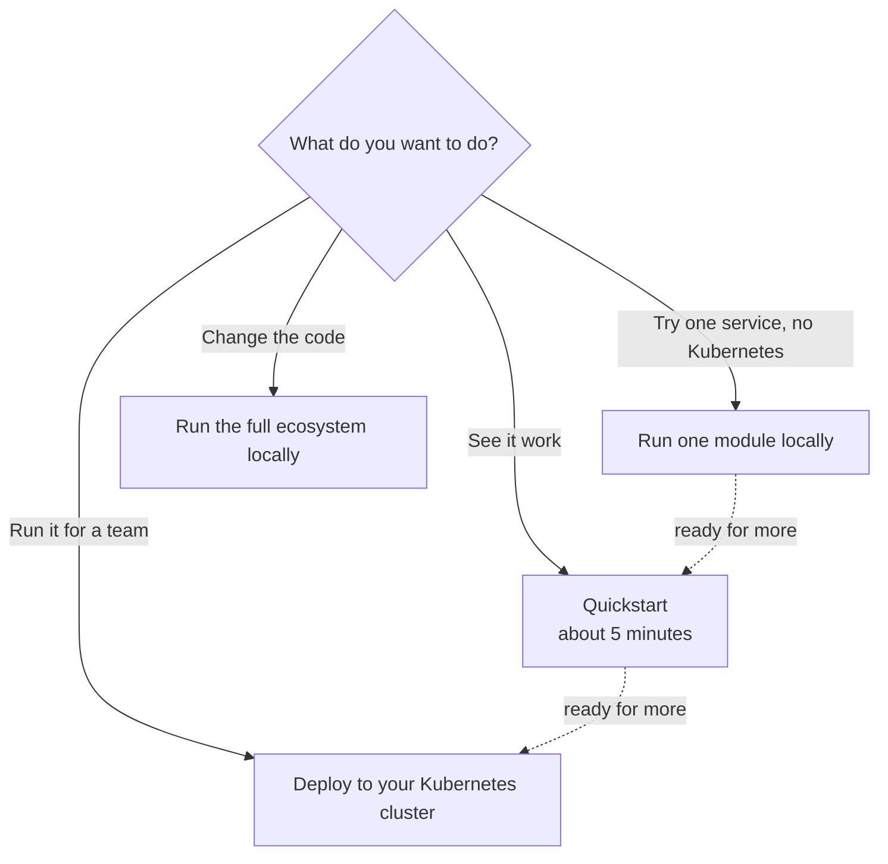

# Get Started

You can have Labs64.IO answering real API requests in about five minutes. No account, license key or sign-up is involved: everything on this page is open source and runs on your own machine or cluster.

Not sure where to begin? Take the [Quickstart](./quickstart.md).

## Pick your path

| You want to… | Take this path | You need | Time to first result |
|---|---|---|---|
| **See it running** and call an API | [Quickstart](./quickstart.md): one script installs the platform on any Kubernetes cluster | `kubectl`, Helm 4, a cluster (a local one is fine) | About 5 minutes |
| **Try one service** without Kubernetes | [Run one module locally](./run-one-module-locally.md): AuditFlow on Docker Compose | Docker, `just`, JDK 25, Maven | A few minutes |
| **Run it for your team** | [Deploy to your Kubernetes cluster](./deploy-to-kubernetes.md): AWS, Azure, GCP or on-premises, with your own identity provider and data stores | A cluster and the infrastructure you intend to keep | An afternoon for a first environment |
| **Change the code** | [Run the full ecosystem locally](./run-the-full-ecosystem-locally.md): every repository, built from source | Docker, and VS Code or a handful of CLI tools | One long first build, then minutes |

The paths build on each other. The Quickstart and a team deployment install the same Helm chart; what changes is who provides the identity provider, the data stores and the secrets. Nothing you learn on the first path is thrown away on the next.

## What you are installing

Labs64.IO is a set of independently deployable services behind one authenticated gateway. You do not have to adopt all of it.

| Piece | What it does for you |
|---|---|
| [Auth Gateway](../modules/auth-gateway/index.md) | Checks every request's token and policy at the edge, so services do not each reimplement it |
| [AuditFlow](../modules/auditflow/index.md) | Takes audit events over one REST call and routes them to the stores you choose |
| [Payment Gateway](../modules/payment-gateway/index.md) | One payment API in front of several payment providers |
| [Checkout](../modules/checkout/index.md) and [Customer Portal](../modules/customer-portal/index.md) | The purchase flow and the customer-facing frontend |

For the vocabulary and the reasoning behind this shape, read [What is Labs64.IO?](../introduction/what-is-labs64-io.md) and [Core concepts](../introduction/core-concepts.md). Neither is required before the Quickstart.

## When you get stuck

- [Troubleshooting your first run](./troubleshooting.md) covers the problems people actually hit on day one.
- [Compare the paths](./choose-a-deployment-path.md) shows side by side what each path installs and what it is not meant for.
- Found a bug or a gap in these pages? Open an issue in the [repository it belongs to](../development/workspace-repositories.md), or use the "Edit this page on GitHub" link at the bottom of any page.
