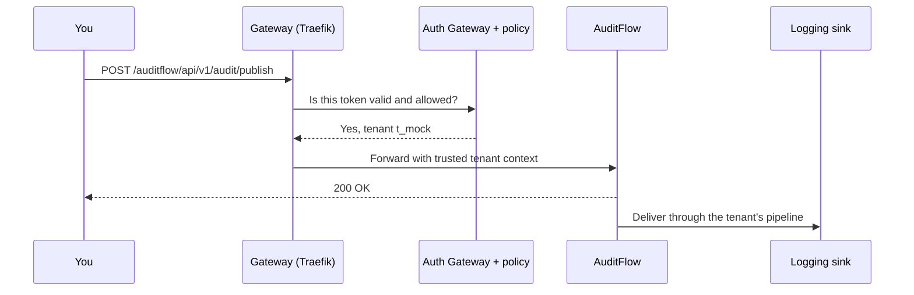

# Quickstart: running in five minutes

One script installs Labs64.IO on a Kubernetes cluster, then sends a real request through it to prove the install works. A throwaway cluster on your laptop is enough. You finish with a gateway you can `curl`, interactive API docs, and an audit event you published yourself.

On a laptop with nothing cached, creating the cluster takes about 20 seconds and the install three to four minutes. Most of that is image downloads.

> **This is an evaluation install.** It includes a demo identity provider that hands a valid token to anyone who asks. Keep it on a local or private cluster. On a cloud cluster the gateway usually gets a public load balancer address, and the demo token endpoint with it. For anything shared, follow [Deploy to your Kubernetes cluster](./deploy-to-kubernetes.md).

## What you need

| You need | Version | Check with |
|---|---|---|
| `kubectl` | 1.27 or newer | `kubectl version --client` |
| Helm | 4.0 or newer | `helm version --short` |
| `curl` | any | `curl --version` |
| A Kubernetes cluster | any recent one | `kubectl get nodes` |

Helm 3 is not enough: the installer stops with `helm 4.0+ is required`.

On the cluster, you need permission to create namespaces and custom resource definitions, and a default StorageClass, which every local distribution ships with. A local cluster needs about 4 GB of memory available to Docker; the running install uses roughly 2.5 GB.

## 1. Get a cluster

If you already have one, make sure `kubectl config current-context` names it and go to step 2.

Otherwise create a local one with [k3d](https://k3d.io/), which runs Kubernetes inside Docker:

```bash
k3d cluster create labs64io-demo \
  -p "8000:80@loadbalancer" \
  --k3s-arg "--disable=traefik@server:0"
```

The first flag publishes the gateway on `http://localhost:8000`. The second turns off the Traefik that k3s bundles, because Labs64.IO installs its own gateway and two of them would compete.

**Using another cluster?** kind, minikube, Docker Desktop, Rancher Desktop and managed clusters (EKS, AKS, GKE) work with the same installer. Two things to know:

- On a k3s-based cluster such as Rancher Desktop, turn off the bundled Traefik first, for the same reason as above.
- If your cluster hands out no load balancer address (kind and minikube by default), the installer prints a `kubectl port-forward` command at the end. Run it in a second terminal, then use `http://localhost:8000`.

## 2. Run the installer

```bash
curl -fsSL https://raw.githubusercontent.com/Labs64/labs64.io-helm-charts/master/install.sh -o install.sh
bash install.sh
```

Downloading the script first, instead of piping it into a shell, lets you read it before it runs. You can also read it on GitHub: [`install.sh`](https://github.com/Labs64/labs64.io-helm-charts/blob/master/install.sh) in `labs64.io-helm-charts`. You use the same file later to check, stop and remove the install.

The installer shows which cluster it is about to change and asks you to confirm. Then choose **Install or update**, then **Quickstart**. Both are the defaults, so pressing Enter three times is enough.

To skip the questions:

```bash
LABS64_PROFILE=quickstart bash install.sh
```

While it runs, the installer:

1. checks your tools, your permissions and the cluster's storage,
2. installs the Gateway API resource definitions, if the cluster has none,
3. generates passwords for the bundled data stores and writes them, with the rest of the configuration, to `./labs64.io-install/`,
4. installs the latest published [`labs64io-ecosystem`](https://artifacthub.io/packages/helm/labs64io-helm-charts/labs64io-ecosystem) Helm chart into the `labs64io` namespace and waits for every pod,
5. requests a token, publishes an audit event through the gateway, and reports each step.

It ends like this:

```text
  PASS  Gateway reachable at http://localhost:8000
  PASS  Swagger UI reachable at http://localhost:8000/swagger-ui/
  PASS  Swagger UI TopBar has 2 API definition(s) configured
  PASS  Obtained a demo access token from mock-oidc
  PASS  Published a demo audit event (HTTP 200) — first good request succeeded

Smoke test: 5 passed, 0 failed — the quickstart flow works end to end.

 Try it yourself (DEV ONLY — mock-oidc authenticates nobody):
   ...

────────────────────────────────────────────────────────────────
 Labs64.IO is ready.

   Base URL:  http://localhost:8000
   API docs:  http://localhost:8000/swagger-ui/

 Enabled modules:
   - api-gateway
   - authz-pdp
   - api-docs
   - auditflow
   - payment-gateway

 Next steps:
   bash install.sh smoke       re-run the checks above any time
   bash install.sh status      what is installed, and is it healthy
   bash install.sh stop        scale everything to zero (keeps data)
   bash install.sh start       restore previous replica counts
   bash install.sh uninstall   remove what this wizard created

   Generated config: ./labs64.io-install/
────────────────────────────────────────────────────────────────
```

The "Try it yourself" block prints the token and publish commands of step 3 with your address filled in.

If the installer cannot work out an address your machine can reach, for example when you run it inside a dev container, tell it:

```bash
LABS64_GATEWAY_URL=http://localhost:8000 bash install.sh smoke
```

## 3. Send your first request

Set the address the installer printed as **Base URL**:

```bash
BASE=http://localhost:8000
```

**Call the API without a token.** The gateway refuses it before the request reaches a service:

```bash
curl -s -X POST $BASE/auditflow/api/v1/audit/publish \
  -H 'Content-Type: application/json' -d '{}'
```

```json
{"code":"UNAUTHORIZED","message":"Missing or malformed Authorization header", ...}
```

**Get a token** from the demo identity provider:

```bash
TOKEN=$(curl -s -X POST $BASE/labs64io/token \
  -H 'Host: mock-oidc.labs64io.svc.cluster.local:8080' \
  -H 'Content-Type: application/x-www-form-urlencoded' \
  --data-urlencode 'grant_type=client_credentials' \
  --data-urlencode 'client_id=local-test' \
  --data-urlencode 'client_secret=local-test' \
  --data-urlencode 'scope=admin' \
  | sed -n 's/.*"access_token"[[:space:]]*:[[:space:]]*"\([^"]*\)".*/\1/p')
```

Keep the `Host` header. The demo identity provider names itself after the host it is called on, and the gateway only accepts tokens issued under the in-cluster name. Leave the header out and the next call fails with `401 Invalid token: Invalid issuer`. A real identity provider has a fixed issuer and needs none of this.

**Publish an audit event:**

```bash
curl -i -X POST $BASE/auditflow/api/v1/audit/publish \
  -H "Authorization: Bearer $TOKEN" \
  -H 'Content-Type: application/json' \
  -d '{"eventType":"demo.hello","sourceSystem":"quickstart"}'
```

```text
HTTP/1.1 200 OK

Audit event published successfully
```

**Watch it arrive.** The demo tenant routes every event to a logging sink, so the delivered event shows up in the sink's log:

```bash
kubectl -n labs64io logs deploy/labs64io-auditflow -c auditflow-sink --tail=12
```

```text
  "eventType": "demo.hello",
  "sourceSystem": "quickstart",
  "tenantId": "t_mock",
```

Your request went through the gateway, was authenticated and authorized, was buffered on the message broker, matched a tenant pipeline and was delivered. The `tenantId` came from your token, not from the request body.



## 4. Look around

**See authorization at work.** The demo identity provider issues four personas; ask for one with the `scope` parameter of the token request. The same two calls give different answers:

| `scope` | Publish an audit event | List payment providers |
|---|---|---|
| `admin` | 200 | 200 |
| `auditflow` | 200 | 403 |
| `ecommerce` | 403 | 200 |
| `no-access` | 403 | 403 |

```bash
curl -s -H "Authorization: Bearer $TOKEN" $BASE/payment-gateway/api/v1/payment-providers
```

**Browse the APIs.** Open `http://localhost:8000/swagger-ui/` for the AuditFlow and Payment Gateway contracts.

**See what is running:**

```bash
kubectl -n labs64io get pods
```

| Workload | What it is |
|---|---|
| `labs64io-traefik` | The gateway. Every request enters here. |
| `gateway-common` | [Auth Gateway](../modules/auth-gateway/index.md): validates tokens and asks the policy engine. |
| `labs64io-authz-pdp` | The policy decision point (Cerbos). |
| `labs64io-auditflow` | [AuditFlow](../modules/auditflow/index.md): backend, transformer and sink in one pod. |
| `labs64io-payment-gateway` | [Payment Gateway](../modules/payment-gateway/index.md). |
| `labs64io-api-docs` | Swagger UI for the installed modules. |
| `labs64io-postgresql`, `labs64io-rabbitmq`, `labs64io-redis-primary` | Bundled data stores, with generated passwords. |
| `mock-oidc` | The demo identity provider. |

Checkout and Customer Portal are not part of this install. To work with them, [run the full ecosystem from source](./run-the-full-ecosystem-locally.md).

## Install with your own identity provider

The installer has a second profile, **BYO** (bring your own). It leaves the demo identity provider out, so it suits a cluster that other people can reach. Run `bash install.sh`, choose **Install or update**, then **BYO**. The installer then asks:

| Question | Default |
|---|---|
| OIDC discovery URL | none, you must answer |
| Install Traefik and a Gateway? | yes |
| Enable API Gateway, Authz PDP, API Docs, AuditFlow, Payment Gateway (one question each) | yes |
| Enable Checkout, Enable Customer Portal (one question each) | no |

To answer every question with its default, set the profile and the discovery URL up front:

```bash
LABS64_PROFILE=byo \
LABS64_OIDC_DISCOVERY_URL=https://idp.example.com/realms/acme/.well-known/openid-configuration \
bash install.sh
```

The BYO profile still runs PostgreSQL, RabbitMQ and Redis inside the cluster, with generated passwords. Both profiles use a data store that already exists instead: if the `labs64io` namespace already has a Service named `labs64io-postgresql`, `labs64io-rabbitmq` or `labs64io-redis-primary` that the installer did not create, the installer connects to it and never removes it. The same goes for an existing Gateway named `labs64io-gateway` in the `tools` namespace. The BYO smoke test checks the gateway and Swagger UI and skips the token and publish steps, because there is no demo identity provider to ask for a token.

If you answer yes to Checkout or Customer Portal, the installer installs their charts but publishes no gateway route for them, and it does not give Checkout the policy engine address it needs. Neither becomes usable through the gateway this way. To work with them, [run the full ecosystem from source](./run-the-full-ecosystem-locally.md).

[Deploy to your Kubernetes cluster](./deploy-to-kubernetes.md#route-a-the-installer-with-your-identity-provider) explains how to prepare a cluster for the BYO profile and when to move on to your own Helm values.

## Manage the install

Run these from the directory where you ran the installer, against the same cluster:

| Command | What it does |
|---|---|
| `bash install.sh status` | Shows what is installed and whether it is healthy. Exits non-zero if not. |
| `bash install.sh smoke` | Repeats the token and publish check. Exits non-zero if a check fails. |
| `bash install.sh stop` | Scales everything to zero. Data and secrets stay. |
| `bash install.sh start` | Brings back the previous replica counts. |
| `bash install.sh` | Opens a menu with every action below. |
| `bash install.sh install` | Runs again safely: same chart version, same passwords. |
| `bash install.sh install --dry-run` | Checks the install against the cluster and writes the generated files, without changing the cluster. |
| `LABS64_CHART_VERSION=<version> bash install.sh install` | Moves to another chart version. |
| `bash install.sh uninstall` | Removes what the installer created. It asks about each kind of resource separately and keeps data volumes unless you say otherwise. |

The installer labels what it creates and records it in the ConfigMap `labs64io-installer-state` in the `labs64io` namespace. `uninstall` removes only what that ConfigMap records, and never a data store or Gateway the installer found already there.

Each command asks you to confirm the cluster first. Add `LABS64_YES=1` in front to accept the defaults without being asked.

The installer keeps its working files in `./labs64.io-install/`: the Helm values it generated (`values-overrides.yaml`), the passwords (`secrets.yaml`, readable only by you) and a full transcript of the last run (`install.log`). `bash install.sh --help` lists every setting, and `bash install.sh --version` prints the installer's version.

## Clean up

If you created the k3d cluster only for this:

```bash
k3d cluster delete labs64io-demo
```

On a cluster you are keeping, run `bash install.sh uninstall`.

## If something goes wrong

The installer names the cause where it can and writes everything to `./labs64.io-install/install.log`. The usual first-run problems, with fixes, are in [Troubleshooting your first run](./troubleshooting.md).

## Next steps

| You want to… | Go to |
|---|---|
| Send events somewhere useful: OpenSearch, S3, Splunk, ClickHouse | [AuditFlow](../modules/auditflow/index.md) |
| Understand what the gateway just did | [Auth Gateway](../modules/auth-gateway/index.md) · [Core concepts](../introduction/core-concepts.md) |
| Install it for a team, with your own identity provider and data stores | [Deploy to your Kubernetes cluster](./deploy-to-kubernetes.md) |
| Change the code | [Run the full ecosystem locally](./run-the-full-ecosystem-locally.md) |
