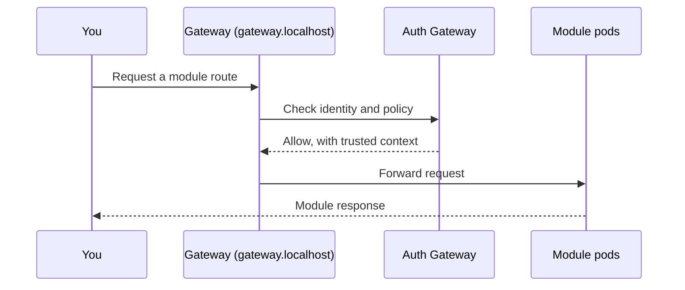

# Run the Full Ecosystem Locally

This is the contributor's setup: every repository checked out side by side, every image built from your working copy, and the whole platform deployed to a local Kubernetes cluster. Use it when you want to change code and see the change behave among the other services.

If you only want to see the platform run, the [Quickstart](./quickstart.md) gets you there in minutes with published images and nothing to build.

## What you need

The workspace gives you two ways to get the tooling. Either is fine.

**A dev container (recommended).** Install [Docker Desktop](https://www.docker.com/products/docker-desktop/) and [VS Code](https://code.visualstudio.com/) with the Dev Containers extension. The container brings every tool at the version the project pins.

**Your own machine.** Install Docker, [k3d](https://k3d.io/), [Helm](https://helm.sh/) 4 with the helm-diff plugin, [Helmfile](https://helmfile.io/), `kubectl` and [`just`](https://github.com/casey/just). `just doctor` then tells you what is missing or at a different version than the project pins.

Either way you do not need Java, Maven or Node on your machine to build: images are built inside a builder container. Give Docker at least 4 CPUs and 8 GB of memory, and keep ports 80, 443 and 5005 free.

## 1. Get the workspace

The workspace repository holds the tooling. The service repositories are cloned next to it, not inside it, so start in an empty folder:

```bash
mkdir labs64.io && cd labs64.io
git clone https://github.com/Labs64/labs64.io-workspace.git
cd labs64.io-workspace
```

Keep the folder name `labs64.io-workspace`; the dev container expects it.

Using the dev container? Open the `labs64.io-workspace` folder in VS Code now and choose **Reopen in Container**. Run the remaining commands in its terminal.

## 2. Check your tools and fetch the repositories

```bash
just doctor    # what is installed, what is missing, what differs from the pinned version
just clone     # clone the service, chart, test and docs repositories next to the workspace
```

Your folder now looks like this:

```text
labs64.io/
├── labs64.io-workspace/      you are here: justfile, dev container, scripts
├── labs64.io-auditflow/
├── labs64.io-checkout/
├── labs64.io-helm-charts/
└── ...
```

## 3. Build and start everything

```bash
just up
```

This one command creates a k3d cluster named `labs64io` with a local image registry, builds every service image from your checkouts, and deploys the platform with its supporting tools. The first run downloads base images and dependencies and builds everything, so start it and get a coffee. Later runs reuse the caches.

It finishes with:

```text
Local environment ready: http://gateway.localhost/swagger-ui/
```

## 4. Check that it works

```bash
kubectl get pods -n labs64io    # the Labs64.IO services
kubectl get pods -n tools       # gateway, data stores, identity provider
```

Open <http://gateway.localhost/swagger-ui/> for the API documentation of every installed service.

Then make an authenticated call. The local identity provider is a mock that issues a token for whichever persona you name:

```bash
TOKEN=$(curl -s -X POST http://mock-oidc.localhost/labs64io/token \
  -H 'Content-Type: application/x-www-form-urlencoded' \
  --data-urlencode 'grant_type=client_credentials' \
  --data-urlencode 'client_id=local-test' \
  --data-urlencode 'client_secret=local-test' \
  --data-urlencode 'scope=admin' \
  | sed -n 's/.*"access_token"[[:space:]]*:[[:space:]]*"\([^"]*\)".*/\1/p')

curl -i -X POST http://gateway.localhost/auditflow/api/v1/audit/publish \
  -H "Authorization: Bearer $TOKEN" \
  -H 'Content-Type: application/json' \
  -d '{"eventType":"demo.hello","sourceSystem":"local"}'
```

The personas are `admin`, `auditflow`, `ecommerce` and `no-access`. From `labs64.io-helm-charts`, `just generate-jwt <persona>` prints the same token response.



## 5. Work on a change

There are two loops, and most of your time goes into the first.

**The fast loop, inside one repository.** Each service repository runs on its own with hot reload, without the cluster: `just up` in `labs64.io-auditflow`, `just dev-up` and `just dev-watch` in a backend folder such as `checkout-be/`, `npm run dev` in a frontend folder. Each repository's `AGENTS.md` and `README.md` list its commands and its tests.

**The full loop, in the cluster.** When the change has to prove itself among the other services, run these from `labs64.io-workspace`:

| Command | What it does |
|---|---|
| `just build <module>` | Rebuilds one module's images and pushes them to the local registry, for example `just build auditflow` |
| `just up` | Builds every image and applies the charts from your checkouts |
| `just smoke` | Runs the fast smoke tests against the cluster |
| `just test` | Runs the full local regression gate |
| `just logs` | Shows warnings and errors from every service |
| `just logs <app>` | Follows one service's log, for example `just logs checkout` |
| `just up-otel` | Adds the monitoring stack and opens Grafana |
| `just status` | Shows the pods, services and routes of the local cluster |
| `just show-repos` | Shows `git status` across all repositories |
| `just pull` | Pulls every repository |
| `just down` | Deletes the cluster and its registry |
| `just helm-charts <recipe>`, `just tests <recipe>` | Any recipe of `labs64.io-helm-charts` or `labs64.io-tests`, run in that repository: `just helm-charts install-app auditflow`, `just tests test-module auditflow` |

The local charts pull an image only when the cluster does not have it yet (`IfNotPresent`), so a rebuilt image does not replace one that is already running. To be sure the cluster runs your code, run `just down` and then `just up`.

`just --list` in any repository shows everything it can do. How the local cluster is put together, namespace by namespace, is described in [`DEVELOPERS.md`](https://github.com/Labs64/labs64.io-helm-charts/blob/master/DEVELOPERS.md) in the Helm charts repository.

## Next steps

| You want to… | Go to |
|---|---|
| Open your first pull request | [Contributing Guide](../development/contributing.md) |
| Find which repository owns what | [Workspace and source repositories](../development/workspace-repositories.md) |
| Fix a first-run problem | [Troubleshooting your first run](./troubleshooting.md) |
| Move from a laptop to a shared environment | [Deploy to your Kubernetes cluster](./deploy-to-kubernetes.md) |
