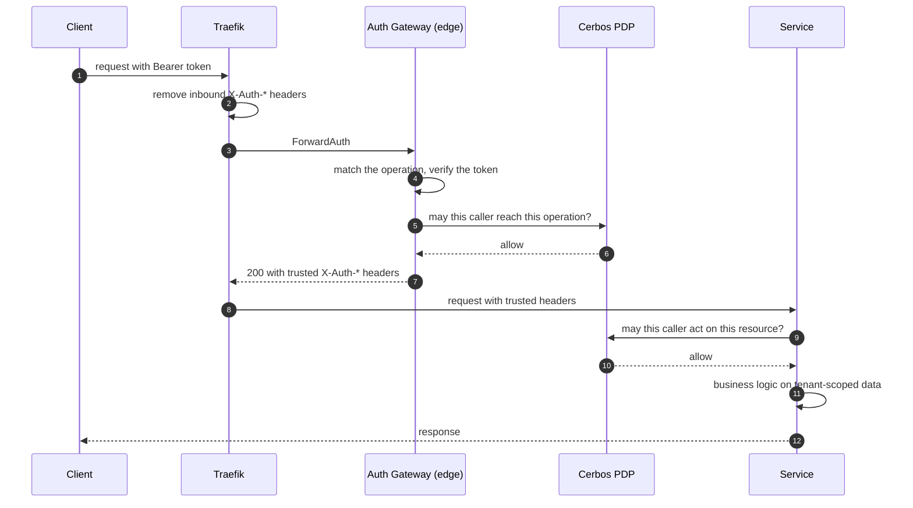
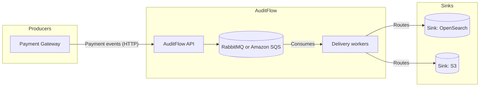
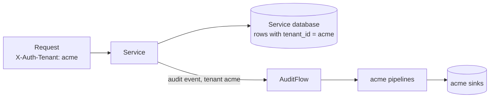
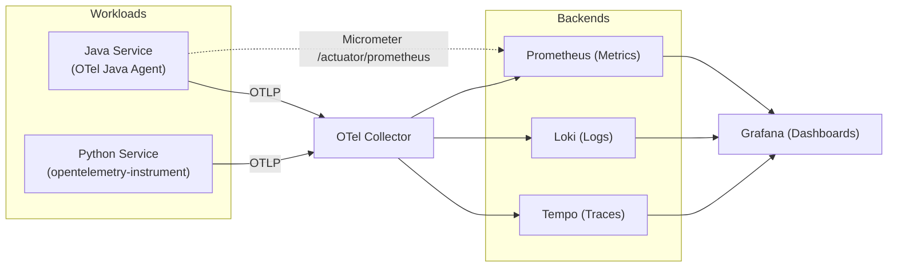
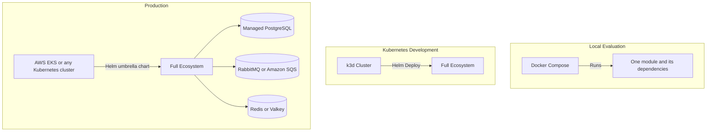

# Architecture Overview

This page outlines the core architectural principles and flows of the Labs64.IO ecosystem. The platform is a set of independent, polyglot services deployed behind one authenticated gateway, each with an OpenAPI contract. Each service owns its API, its data and its release cycle. The platform supplies what they share: identity and access control, tenant isolation, audit delivery, observability and deployment packaging. You can adopt one service or all of them.

## Principles

1. **Authenticate once, at the edge.** Services never see a token. They see only the identity context that the edge issued for the request.
2. **One policy source.** Each service's OpenAPI contract declares who may call which operation. The build generates authorization policy and gateway routing from it.
3. **Fail closed.** An invalid token, an unknown route or an unreachable decision point rejects the request.
4. **Every record has a tenant.** Requests, database rows and audit events carry the tenant they belong to.
5. **Services own their data.** No service reads another service's database. Services integrate through APIs.
6. **Contracts first.** APIs are OpenAPI documents, and the build generates server code from them.
7. **Operations belong to the deployment.** Telemetry, secrets and network policy come from the deployment configuration, not from service code.

## Request Flow

Every external request crosses the edge before it reaches any application code. Traefik is the ingress controller. It removes any `X-Auth-*` headers the client sent, then delegates authentication and authorization to the [Auth Gateway](../modules/auth-gateway/index.md) (`traefik-authproxy`) through ForwardAuth. The Auth Gateway verifies the token and asks the Cerbos policy decision point (PDP).

A request without a token on a protected operation gets `401`. A request that matches no known operation, or that the PDP denies, gets `403`, and Traefik returns that answer to the client without calling the service.

## Identity and access

Several points enforce authorization, and one service decides it. Every check goes to the same central Cerbos PDP and evaluates the same generated policy.

| Enforcement point | Where | Checks |
|---|---|---|
| Edge | [Auth Gateway](../modules/auth-gateway/index.md) | Is the token valid, and may this caller reach this operation at all? |
| Domain | Inside each Java service, through annotations generated from the contract (`@RequireTenant`, `@RequireScopes`, `@Authorize`) | Does the request carry the required tenant and scopes, and may this caller perform this action on this resource? |
| Data | In services that adopt it, such as the Checkout purchase-order list | Which rows may this caller see? The service turns the PDP's query plan into a database filter. |

`@RequireTenant` and `@RequireScopes` check the identity context inside the service. `@Authorize` asks the PDP about the specific resource, for example one purchase order or one payment, and denies the request when the PDP cannot be reached.

### The identity context

After a successful edge check, the service receives four headers and nothing else about the caller:

| Header | Content |
|---|---|
| `X-Auth-User` | The caller, from the token's `preferred_username` or `sub` claim. A token with neither gets `svc:<client id>`. |
| `X-Auth-Scopes` | The caller's scopes, comma-separated. |
| `X-Auth-Tenant` | The caller's tenant from the token's tenant claim, or `-` for a call without a tenant. |
| `X-Request-ID` | The caller's request ID when it is well-formed, otherwise a generated UUIDv7. Services pass it on with every downstream call. |

The Auth Gateway sets all four headers on every successful check, so a value the client sent never survives. It keeps only the characters `a-z A-Z 0-9 _ . : -` in each value. The [Commons](https://github.com/Labs64/labs64.io-commons) auth-context libraries for Java and Python parse these headers, reject a request to a protected path that has no user with `401`, and add the headers to outbound calls.

### Policy from the contract

Each operation in a service's OpenAPI document can carry an `x-labs64.auth` block with the required scopes (`scopes`), whether a tenant is required (`tenant: true`) and, for resource-level checks, a `resourceType`. An operation that declares none of these is public. At build time this block generates three things:

- the domain annotations on the service's generated API interfaces,
- the Cerbos policies and schemas that the PDP loads,
- the routing manifest that the Auth Gateway uses to match a request to an operation.

Routing, edge policy and service checks therefore come from the same source and cannot disagree. See [OpenAPI contracts](../reference/openapi.md) for where each contract lives.

### Service-to-service calls

Services call each other directly inside the cluster, through the target's Kubernetes Service, not through Traefik. A service acting on its own behalf sends the same four headers and identifies itself as a service principal. For example, Payment Gateway sends audit events to AuditFlow with `X-Auth-User: svc:payment-gateway`, the scopes from its integration configuration (`audit-event:write` by default) and the tenant of the payment it reports. The calling service never forwards the original end user as the authenticated caller. The PDP gives every `svc:` caller the `service` role.

### Trust boundary

Only the edge is reachable from outside the cluster. Inside the cluster, services trust the identity headers they receive, so any workload that can reach a service directly can forge them. Kubernetes NetworkPolicies close this path by admitting only Traefik and named caller services to each service's API port. The platform does not verify in-cluster callers cryptographically (no mTLS or workload identity).

Public operations, such as payment provider webhooks, carry no user identity. The owning service checks their authenticity itself. Payment Gateway, for example, verifies the provider's webhook signature and takes the tenant from the stored payment, never from the webhook payload.

**Before you go live:**

- Turn on NetworkPolicies. The module charts ship with `networkPolicy.enabled: false`. Without them, any pod in the cluster can call a service with forged `X-Auth-*` headers, and AuditFlow's unauthenticated `/actuator` endpoints, including the dead-letter purge, are reachable.
- Keep every service behind Traefik. A route that bypasses the Auth Gateway passes client-supplied identity headers straight to the service.

See [Security & Compliance](../operate-manage/security-compliance.md) for the full deployment checklist.

## Event-Driven Architecture

Services call each other synchronously over REST. Audit events go to [AuditFlow](../modules/auditflow/index.md) over its HTTP API, sent by an authenticated service principal. AuditFlow stores each event on its own message broker, RabbitMQ or Amazon SQS depending on its configuration, before it answers. It then routes the event through the pipelines of the event's tenant to the configured sinks.

AuditFlow routes events and does not store them. The sinks are the systems of record. No service reads another service's database. See [Choose a message broker](../modules/auditflow/deployment/index.md#choose-a-message-broker) for the broker options.

## Multi-Tenancy

The tenant comes from the token and travels as `X-Auth-Tenant`. Each service stores the tenant in a `tenant_id` column on every row and scopes every query by it. Each service has its own database and its own credentials. AuditFlow routes an event only through the pipelines its tenant owns, with a quota, sink credentials and a dead-letter queue per tenant. Events without a tenant belong to the reserved `_platform` pseudo-tenant.

See [Scaling & Multi-Tenancy](../operate-manage/scaling-multi-tenancy.md).

## Observability Pipeline

Observability is infrastructure-owned. Services do not carry OpenTelemetry SDKs. Instead, the OpenTelemetry Java agent (Java services) and `opentelemetry-instrument` (Python services) attach at runtime when the deployment turns observability on.

The same image runs with observability on or off. One Helm value, `observability.enabled`, switches it, and no rebuild is needed. Java services expose their metrics through Micrometer at `/actuator/prometheus` in both modes. See [Monitoring & Observability](../operate-manage/monitoring-observability.md).

[Monitoring & Observability](../operate-manage/monitoring-observability.md) shows how to collect these signals in each deployment, and which alerts tell you that events are not arriving.

## Deployment Architecture

Every service ships as a container image and a Helm chart. The `labs64io-ecosystem` umbrella chart installs them together.

The module charts do not bundle PostgreSQL, Redis or RabbitMQ. The umbrella chart installs in-cluster PostgreSQL, Valkey and RabbitMQ by default, which is enough for evaluation. In production you turn those off and point the services at your own identity provider, data stores and secrets.

See **[Get Started](../getting-started/index.md)** for deployment instructions and **[Operate & Manage](../operate-manage/index.md)** for the production operating model.
