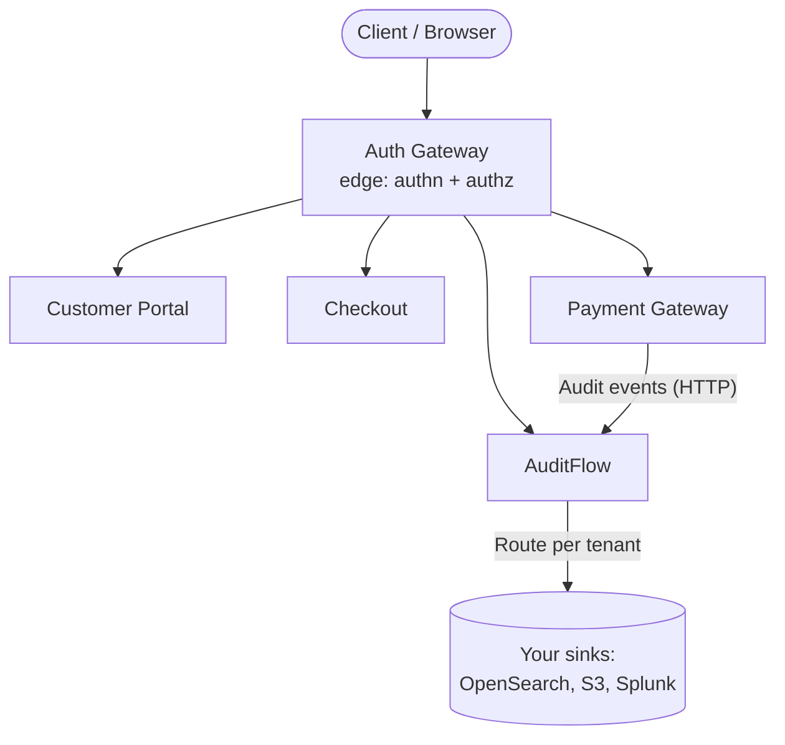

# Labs64.IO Documentation

Build a secure commerce platform one focused capability at a time. Labs64.IO combines independently deployable services with shared identity, policy, routing, observability, and operational conventions.

Whether you are evaluating one service, integrating a product team, or operating the ecosystem on Kubernetes, this guide is the shortest path from first request to a production-ready foundation.

> **In a hurry?** The [Quickstart](../getting-started/quickstart.md) installs the platform on any Kubernetes cluster with one script and has you calling an API in about five minutes.

| I want to… | Start here |
|---|---|
| Understand the platform and its vocabulary | [What is Labs64.IO?](./what-is-labs64-io.md) · [Core concepts](./core-concepts.md) · [Architecture](./architecture.md) |
| Run it: on a laptop, on my cluster, or from source | [Get started](../getting-started/index.md) |
| Explore a product capability | [Services & Modules](../modules/index.md) |
| Run the platform reliably | [Operate & Manage](../operate-manage/index.md) |
| Find a contract or setting | [Reference](../reference/index.md) |
| Let an AI agent read the docs, call the APIs or change the code | [Working with AI agents](./ai-agents.md) |
| See every module and its source repository | [The Labs64.IO ecosystem](../modules/index.md#the-labs64io-ecosystem) |
| Check the license | [License](../development/contributing.md#license) |

## The ecosystem at a glance

Every external request enters through the Auth Gateway. Inside the cluster, services call each other's REST APIs directly as service principals. Payment Gateway, for example, sends audit events to AuditFlow over its HTTP API. No service reads another service's database. The [Architecture Overview](./architecture.md) explains the request flow, identity and access, and tenant isolation.

## A practical path to value

1. **Choose a path.** Install the platform in minutes with the Quickstart, run one service locally, prepare a Kubernetes environment for your team, or build everything from source.
2. **Use a capability.** Each service page explains its role, integration boundary, configuration, operations, and next step.
3. **Operate with confidence.** Apply the shared deployment, security, observability, and tenancy patterns before production.

> **How to read availability**
>
> Service pages marked **Planned** describe the intended integration and operating model. They help you design ahead, but are not a callable product contract yet. Pages without that badge document the services you can evaluate today.

## Documentation map

| Section | For | What you will find |
|---|---|---|
| [Overview](./index.md) | Everyone | Platform purpose, concepts, and architecture |
| [Get Started](../getting-started/index.md) | First adopters and contributors | A five-minute quickstart, then local, cluster and from-source paths |
| [Services & Modules](../modules/index.md) | Builders | Product areas, service roles, and integration paths |
| [Operate & Manage](../operate-manage/index.md) | Platform teams | Helm, routing, persistence, scaling, security, and runbooks |
| [Reference](../reference/index.md) | Integrators | APIs, events, configuration, images, charts, and glossary |
