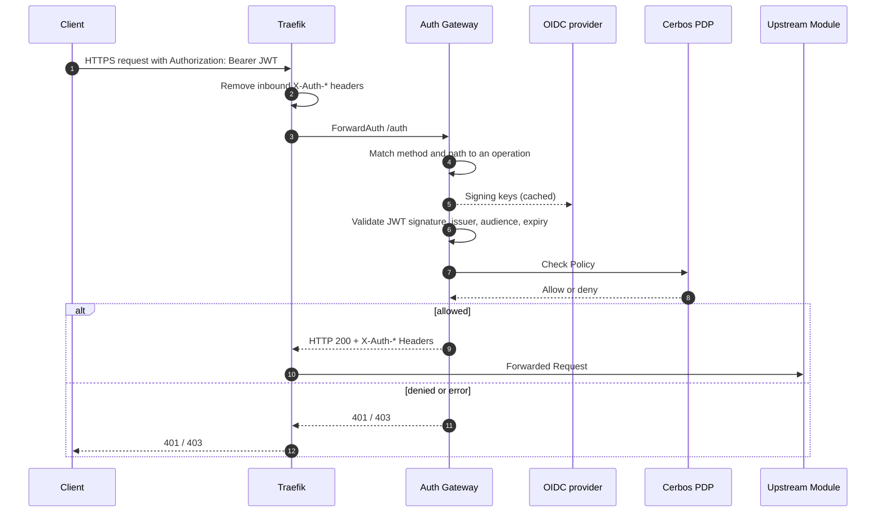

# Auth Gateway

## Overview
The Auth Gateway (`traefik-authproxy`) provides the authenticated edge for the entire Labs64.IO ecosystem. It enforces authentication via OIDC/JWT and delegates authorization decisions to the Cerbos Policy Decision Point (PDP) before requests reach any module. It hands the module a trusted identity context instead of the token, so modules never validate tokens themselves.

The `api-gateway` Helm chart deploys the Auth Gateway together with the shared Traefik middlewares. The `authz-pdp` chart deploys the Cerbos PDP.

The Auth Gateway decides who may call which operation. It is not a general-purpose ingress controller or CDN. Traefik routes the traffic and asks the Auth Gateway for each decision.

## Capabilities

| Capability | Description |
|------------|-------------|
| **Centralized Authentication** | Validates RS256 JWTs from identity providers (e.g., Keycloak, Auth0). The signing keys come from the provider's discovery document and are cached and refreshed when the provider rotates them. |
| **Centralized Authorization** | Matches each request to an operation of a module's OpenAPI contract and queries Cerbos for policy-as-code evaluation. |
| **Trusted Header Injection** | Passes validated context (`X-Auth-User`, `X-Auth-Scopes`, `X-Auth-Tenant`, `X-Request-ID`) to upstream modules. |
| **Header-smuggling protection** | Traefik removes client-supplied `X-Auth-User`, `X-Auth-Scopes` and `X-Auth-Tenant` on every route, public ones included, before anything else runs. |
| **Fail Closed** | Rejects unmapped or unauthorized routes explicitly. An invalid token or an unreachable PDP also rejects the request. |
| **Rate limiting** | A Traefik rate-limit middleware runs on every protected route, per authenticated user by default. |
| **Security response headers** | Every route sets `X-Frame-Options`, `X-Content-Type-Options`, `Referrer-Policy`, `Content-Security-Policy` and `Strict-Transport-Security` on the response. See [Gateway API](../../operate-manage/kubernetes-helm-setup.md#gateway-api). |
| **Hot reload** | Route manifests reload without a restart. |

## Architecture

Auth Gateway uses Traefik's `ForwardAuth` middleware.



**Route matching.** Each module's OpenAPI contract declares, per operation, whether the operation is public and which scopes it needs (`x-labs64.auth`). The build turns this into one routes manifest per module and the matching Cerbos policies, so the gateway's routing and the policy follow the published API. The Auth Gateway loads the manifests from `ROUTES_DIR`. Paths without an OpenAPI contract, such as UI bundles and the AuditFlow dead-letter endpoints, use static prefix rules from `STATIC_ROUTES_FILE`. The Auth Gateway consults those only when no operation matches, and it rejects a request that matches neither with `403`. When two modules declare the same method and path, the Auth Gateway rejects that route with `403` "Conflicting auth policy" and logs the conflict.

The `api-gateway` chart packages the routes manifests of the AuditFlow, Checkout and Payment Gateway contracts, and the `authz-pdp` chart packages the matching Cerbos policies. A chart release therefore carries routes and policies that belong together. The chart's `staticPolicies` value holds the static prefix rules.

**The decision.** For a matched operation, the Auth Gateway sends Cerbos one check. The resource kind is `<module>_api` (for example `payment_gateway_api`), the action is the operation ID, and the caller's scopes and tenant are attributes. A static rule uses the kind `static_api` and the rule's ID as the action. A public operation, such as a payment provider's webhook, is checked without a token. The Auth Gateway treats a caller whose ID starts with `svc:` as a service principal.

**The identity context.** The Auth Gateway sets all four headers on every allowed response, empty when not applicable, so Traefik always overwrites anything a client sent. It removes every character outside `[a-zA-Z0-9_.:-]` from the values. Scopes are the union of the token's `scope` claim and Keycloak-style role claims (`TOKEN_SCOPES_CLAIM_PATHS`). The tenant comes from the `tenant` claim (`TOKEN_TENANT_CLAIM_PATH`).

## Quick Start

The Auth Gateway is part of every Kubernetes install; you do not start it separately. The [Quickstart](../../getting-started/quickstart.md) installs it in about five minutes and walks through the three answers it gives.

A request without a token is refused with `401`:
```bash
curl -i -X POST http://localhost:8000/auditflow/api/v1/audit/publish \
  -H 'Content-Type: application/json' -d '{}'
```

A request with a valid token that lacks the required scope is refused with `403`, and one with the right scope is forwarded to the service with a trusted tenant and user context.

### Install with Helm

On a cluster that already runs Traefik with the shared `Gateway` (see [Gateway API](../../operate-manage/kubernetes-helm-setup.md#gateway-api)), install the policy engine and the gateway chart in front of your modules, and point it at your identity provider's discovery endpoint:

```bash
helm repo add labs64io https://labs64.github.io/labs64.io-helm-charts
helm repo update

helm install labs64io-authz-pdp labs64io/authz-pdp -n labs64io --create-namespace
helm install api-gateway labs64io/api-gateway -n labs64io \
  --set oidc.discoveryUrl=https://idp.example.com/realms/acme/.well-known/openid-configuration
```

The `api-gateway` chart expects the PDP at `http://labs64io-authz-pdp:3592`, which is the Service that a release named `labs64io-authz-pdp` creates. With another release name, set `cerbos.url` to match. The umbrella chart and `install.sh` wire both charts for you, which is why the [installer](../../getting-started/deploy-to-kubernetes.md#route-a-the-installer-with-your-identity-provider) is the easier first step. The chart is on [Artifact Hub](https://artifacthub.io/packages/helm/labs64io-helm-charts/api-gateway).

### Try the decision logic with Docker

Only Docker is needed. Run the published auth proxy on its own and ask it to decide on a request:

```bash
docker run -d --rm --name authproxy -p 8081:8081 labs64/traefik-authproxy:latest

curl -s localhost:8081/health
# {"status":"ok","jwks_cached":false,"ready":false,"modules":0,"routes":0,...}
curl -i localhost:8081/auth \
  -H "X-Forwarded-Method: GET" \
  -H "X-Forwarded-Uri: /payment-gateway/api/v1/payments"
```

No routes are loaded, so the request is **denied** (see [Failing closed](#failing-closed)): the gateway never guesses. Clean up with `docker rm -f authproxy`. This standalone run shows the decision logic only; a complete flow needs an identity provider, the policy engine and route manifests, which the installer sets up for you.

### Build from source

Needs Python 3.14 and Docker:

```bash
git clone https://github.com/Labs64/labs64.io-authproxy.git && cd labs64.io-authproxy/traefik-authproxy
docker build -t traefik-authproxy .          # build the image
pip install -r requirements.txt pytest       # or work in a virtualenv
pytest tests/                                # run the tests
```

The repository's [`AGENTS.md`](https://github.com/Labs64/labs64.io-authproxy/blob/master/AGENTS.md) describes the layout, the environment variables and where to change JWT verification, scope extraction and policy matching.

## Configuration

| Variable | Description | Default |
|----------|-------------|---------|
| `OIDC_DISCOVERY_URL` | OIDC discovery endpoint; the JWKS and issuer are read from it. May be an in-cluster URL. | `{OIDC_URL}/realms/{OIDC_REALM}/.well-known/openid-configuration` |
| `OIDC_URL`, `OIDC_REALM` | Provider base URL and realm, used to build the discovery URL. | mock OIDC, `default` |
| `OIDC_ISSUER` | Canonical JWT issuer. An explicit value takes precedence over the discovery metadata. | discovery document |
| `OIDC_AUDIENCE` | Expected JWT audience. | `account` |
| `TOKEN_SCOPES_CLAIM_PATHS` | Comma-separated claim paths that carry scopes (union of all). `{audience}` expands to `OIDC_AUDIENCE`. | `scope,realm_access.roles,resource_access.{audience}.roles` |
| `TOKEN_TENANT_CLAIM_PATH` | Claim path of the tenant identifier. | `tenant` |
| `CERBOS_URL` | Central Cerbos policy engine (HTTP). | `http://localhost:3592` |
| `CERBOS_TIMEOUT` | Seconds to wait for a PDP answer before the request is denied. | `2.0` |
| `AUTHZ_DECISION_CACHE_TTL` | Seconds a PDP allow or deny is reused for the same caller and operation. `0` asks the PDP on every request. Errors are never cached. | `0` |
| `TOKEN_CACHE_TTL` | Seconds a verified token is reused, never past its `exp`. `0` verifies every request. | `0` |
| `ROUTES_DIR` | Directory of generated `<module>.routes.yaml` manifests (ConfigMap-mounted). | `routes` |
| `STATIC_ROUTES_FILE` | Static prefix policies for surfaces without an OpenAPI spec (UI bundles). | `static_routes.yaml` |
| `JWKS_CACHE_TTL` | Seconds a fetched key set is cached. | `3600` |
| `JWKS_REFRESH_MIN_INTERVAL` | Minimum seconds between refreshes triggered by a token with an unknown key ID. | `60` |
| `JWKS_MAX_STALE` | Seconds the cached keys stay in use past the TTL while the provider is unreachable. After that, requests fail with `500`. | `86400` |
| `LOG_LEVEL` | Log level. | `INFO` |
| `AUTH_ACCESS_LOG_OK` | `true` also writes an access-log line for each allowed `/auth` call. | `false` |

Tokens are verified with RS256 only. Routes and scopes come from each module's OpenAPI contract; `POST /reload` re-reads the manifests without a restart.

With the `api-gateway` Helm chart, set the provider under `oidc` (`discoveryUrl`, `issuer`, `audience`, `scopesClaimPaths`, `tenantClaimPath`), the PDP under `cerbos.url` and the log level under `logLevel`. The chart's default discovery URL points at a Keycloak release in the `tools` namespace. Use `env` for any other variable.

The chart also sets the shared middlewares:

| Value | Default | Description |
|---|---|---|
| `rateLimit.average`, `rateLimit.burst` | `100`, `50` | Requests per second and burst size. |
| `rateLimit.perUser` | `true` | One bucket per `X-Auth-User`. |
| `rateLimit.global` | `false` | One bucket per request host instead, a fixed ceiling for all callers. Overrides `perUser`. |
| `buffering.maxRequestBodyBytes` | `2621440` | Largest request body accepted (2.5 MB). |
| `compress.enabled` | `true` | Compresses responses of at least `compress.minResponseBodyBytes` (1024 bytes). |
| `authProxy.trustForwardHeader` | `false` | Keep it `false`. With `true`, a caller could make the Auth Gateway check a different method and path than the one Traefik serves. |

Traefik keeps the rate-limit buckets in memory, so each limit applies per Traefik replica.

## REST APIs

The Auth Gateway does not expose business APIs. It exposes the endpoints Traefik and the platform use:

| Endpoint | Method | Description |
|----------|--------|-------------|
| `/auth` | `GET`, `POST` | The ForwardAuth target for Traefik: returns `200` with the trusted headers, or `401`/`403`. |
| `/health` | `GET` | Liveness; also reports whether keys and routes are loaded and the PDP address. |
| `/health/ready` | `GET` | Readiness: `503` until at least one module's routes have loaded. |
| `/reload` | `POST` | Re-read the route manifests and static routes from disk. |

With the `api-docs` chart installed, the gateway serves the OpenAPI contracts of every installed module in one Swagger UI at `/swagger-ui`. See the [OpenAPI reference](../../reference/openapi.md).

## Events

The Auth Gateway does not publish domain events. Every module-route decision is logged with a request id.

## Examples

### Upstream trusted headers

When a request is allowed, the Auth Gateway sets these headers for the module:

| Header | Meaning |
|--------|---------|
| `X-Auth-User` | The token's `preferred_username` or `sub`. A token with neither gets `svc:<client>` from its `azp` or `client_id` claim. |
| `X-Auth-Scopes` | Comma-separated scopes. |
| `X-Auth-Tenant` | The tenant, or `-` when the caller is tenant-less. |
| `X-Request-ID` | The caller's id when well-formed, otherwise a generated UUIDv7. |

### Calls from a service or an AI agent

Give each service, CI job or AI agent its own OIDC client that uses the client-credentials grant, with only the scopes it needs. The Auth Gateway checks those scopes on every call. The caller can tell the two refusals apart and stop retrying:

| Status | Meaning |
|---|---|
| `401` | No token, a malformed `Authorization` header, or a token that fails verification (signature, issuer, audience, expiry). |
| `403` | A valid token without the required scope, a policy that denies the call, or a route with no policy. |

The Swagger UI at `/swagger-ui` lists the operations an installed module offers.

### Failing closed

A route with no policy is denied, even for a valid token:

```bash
curl -i localhost:8081/auth -H "X-Forwarded-Method: GET" -H "X-Forwarded-Uri: /payment-gateway/api/v1/payments"
# HTTP/1.1 403 Forbidden
# {"code":"FORBIDDEN","message":"No auth policy configured for: /payment-gateway/api/v1/payments", ...}
```

## Operations

Auth Gateway is stateless and scales horizontally. It needs a reachable OIDC provider, the central Cerbos policy engine and the route manifests; until the manifests load it reports not ready.

The `api-gateway` and `authz-pdp` charts both run two replicas by default, and the `api-gateway` chart adds a PodDisruptionBudget. When the PDP is unreachable, the Auth Gateway denies every request it checks.

The Auth Gateway logs every decision on the `traefik_authproxy` logger:

```text
authz outcome=enforced-<allow|deny> engine=cerbos kind=<resourceKind> action=<action> decision=<allow|deny|error> requestId=<id> — <METHOD> <path>
```

An allow logs at INFO, a deny or an error at WARN. The line leaves out user, tenant and scopes. To see them, raise only the `traefik_authproxy.authz.detail` logger to DEBUG. It writes an `authz-detail` line with the same `requestId`.

## Before you go live

- [ ] Point the gateway at your production identity provider and remove the demo provider, which issues a valid token to anyone. Set `OIDC_ISSUER` explicitly when the discovery URL is an in-cluster address.
- [ ] Make modules reachable only through the gateway. A workload inside the cluster that reaches a module directly can forge `X-Auth-*` headers. Turn on `networkPolicy.enabled` in every chart; it is off by default.
- [ ] Keep `authProxy.trustForwardHeader` at `false`.
- [ ] Run the Cerbos PDP and the Auth Gateway with at least two replicas each.
- [ ] Check `TOKEN_SCOPES_CLAIM_PATHS` against where your provider puts scopes or roles.
- [ ] Keep `AUTHZ_DECISION_CACHE_TTL` and `TOKEN_CACHE_TTL` at a few seconds or `0`. A cached answer outlives a policy change or a withdrawn key for that long.
- [ ] Keep the `traefik_authproxy.authz.detail` logger above DEBUG in shared environments, because it records user, tenant and scopes.

## Troubleshooting

| Symptom | Cause | Resolution |
|---------|-------|------------|
| `403` with "No auth policy configured" | The route is not in any manifest | Check that the module's routes manifest is mounted in `ROUTES_DIR` and call `POST /reload`. |
| `403` with "Conflicting auth policy" | Two modules' manifests declare the same method and path | Find the `Auth-policy conflict` error in the log, which names both modules, and remove the duplicate route. |
| `403` for a valid token | The token lacks the required scope, or the policy denies it | Compare the token's scopes with the operation's required scopes; check the WARN `authz` log line and the Cerbos logs. |
| `401` for every request | Token cannot be verified | Check `OIDC_DISCOVERY_URL`, `OIDC_ISSUER` and `OIDC_AUDIENCE`; compare them with the token's `iss` and `aud`. |
| `500` "Failed to retrieve JWKS" | The discovery endpoint or key set is unreachable | The discovery endpoint in `OIDC_DISCOVERY_URL` must be reachable from the pod. |
| Not ready (`503`) at start | No route manifests loaded yet | Mount the generated `*.routes.yaml` files into `ROUTES_DIR`. |
