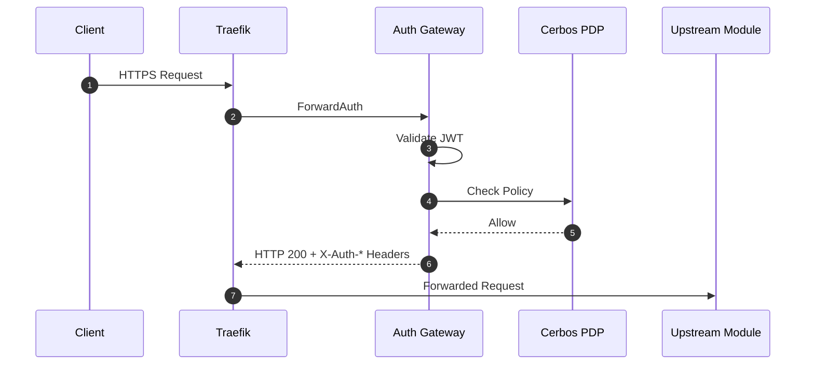

# Auth Gateway

## Overview
The Auth Gateway (`traefik-authproxy`) provides the authenticated edge for the entire Labs64.IO ecosystem. It enforces authentication via OIDC/JWT and delegates authorization decisions to the Cerbos Policy Decision Point (PDP) before requests reach any module.

## Capabilities

| Capability | Description |
|------------|-------------|
| **Centralized Authentication** | Validates JWTs from identity providers (e.g., Keycloak, Auth0). |
| **Centralized Authorization** | Queries Cerbos for policy-as-code evaluation. |
| **Trusted Header Injection** | Passes validated context (`X-Auth-User`, etc.) to upstream modules. |
| **Fail Closed** | Rejects unmapped or unauthorized routes explicitly. |

## Architecture

Auth Gateway leverages Traefik's `ForwardAuth` middleware.



## Quick Start

The Auth Gateway is part of every Kubernetes install; you do not start it separately. The [Quickstart](../../getting-started/quickstart.md) installs it in about five minutes and walks through the three answers it gives.

A request without a token is refused with `401`:
```bash
curl -i -X POST http://localhost:8000/auditflow/api/v1/audit/publish \
  -H 'Content-Type: application/json' -d '{}'
```

A request with a valid token that lacks the required scope is refused with `403`, and one with the right scope is forwarded to the service with a trusted tenant and user context.

### Install with Helm

With a cluster and an OIDC identity provider, install the gateway chart in front of your modules:

```bash
helm repo add labs64io https://labs64.github.io/labs64.io-helm-charts
helm repo update

helm install api-gateway labs64io/api-gateway -n labs64io --create-namespace
```

Then point it at your provider's discovery endpoint (`OIDC_DISCOVERY_URL`), install the policy engine (the `authz-pdp` chart) and mount the route manifests generated from each module's OpenAPI contract. The umbrella chart and `install.sh` wire all of that for you, which is why the [installer](../../getting-started/deploy-to-kubernetes.md) is the easier first step. The chart is on [Artifact Hub](https://artifacthub.io/packages/helm/labs64io-helm-charts/api-gateway).

### Try the decision logic with Docker

Only Docker is needed. Run the published auth proxy on its own and ask it to decide on a request:

```bash
docker run -d --rm --name authproxy -p 8081:8081 labs64/traefik-authproxy:latest

curl -s localhost:8081/health
curl -i localhost:8081/auth \
  -H "X-Forwarded-Method: GET" \
  -H "X-Forwarded-Uri: /payment-gateway/api/v1/payments"
```

No routes are loaded, so the request is **denied** (see [Failing closed](#failing-closed)): the gateway never guesses. Clean up with `docker rm -f authproxy`. This standalone run shows the decision logic only; a complete flow needs an identity provider, the policy engine and route manifests, which the installer sets up for you.

### Build from source

Needs Python 3.14 and Docker:

```bash
git clone https://github.com/Labs64/labs64.io-authproxy.git && cd labs64.io-authproxy/traefik-authproxy
docker build -t traefik-authproxy .          # build the image
pip install -r requirements.txt pytest       # or work in a virtualenv
pytest tests/                                # run the tests
```

The repository's `AGENTS.md` describes the layout, the environment variables and where to change JWT verification, scope extraction and policy matching.

## Configuration

| Variable | Description | Default |
|----------|-------------|---------|
| `OIDC_DISCOVERY_URL` | OIDC discovery endpoint; the JWKS and issuer are read from it. May be an in-cluster URL. | `{OIDC_URL}/realms/{OIDC_REALM}/.well-known/openid-configuration` |
| `OIDC_URL`, `OIDC_REALM` | Provider base URL and realm, used to build the discovery URL. | mock OIDC, `default` |
| `OIDC_ISSUER` | Canonical JWT issuer. An explicit value takes precedence over the discovery metadata. | discovery document |
| `OIDC_AUDIENCE` | Expected JWT audience. | `account` |
| `TOKEN_SCOPES_CLAIM_PATHS` | Comma-separated claim paths that carry scopes (union of all). | `scope,realm_access.roles,resource_access.{audience}.roles` |
| `TOKEN_TENANT_CLAIM_PATH` | Claim path of the tenant identifier. | `tenant` |
| `CERBOS_URL` | Central Cerbos policy engine (HTTP). | `http://localhost:3592` |
| `ROUTES_DIR` | Directory of generated `<module>.routes.yaml` manifests (ConfigMap-mounted). | `routes` |
| `STATIC_ROUTES_FILE` | Static prefix policies for surfaces without an OpenAPI spec (UI bundles). | `static_routes.yaml` |
| `JWKS_CACHE_TTL` | Seconds a fetched key set is cached. | `3600` |

Tokens are verified with RS256 only. Routes and scopes come from each module's OpenAPI contract; `POST /reload` re-reads the manifests without a restart.

## REST APIs

The Auth Gateway does not expose business APIs. It exposes the endpoints Traefik and the platform use:

| Endpoint | Method | Description |
|----------|--------|-------------|
| `/auth` | `GET` | The ForwardAuth target for Traefik: returns `200` with the trusted headers, or `401`/`403`. |
| `/health` | `GET` | Liveness; also reports whether keys and routes are loaded. |
| `/health/ready` | `GET` | Readiness: `503` until at least one module's routes have loaded. |
| `/reload` | `POST` | Re-read the route manifests and static routes from disk. |

## Events

The Auth Gateway does not publish domain events. Every module-route decision is logged with a request id.

## Examples

### Upstream trusted headers

When a request is allowed, the Auth Gateway sets these headers for the module:

| Header | Meaning |
|--------|---------|
| `X-Auth-User` | The subject, or `svc:<client>` for a service principal. |
| `X-Auth-Scopes` | Comma-separated scopes. |
| `X-Auth-Tenant` | The tenant, or `-` when the caller is tenant-less. |
| `X-Request-ID` | The caller's id when well-formed, otherwise a generated UUIDv7. |

### Failing closed

A route with no policy is denied, even for a valid token:

```bash
curl -i localhost:8081/auth -H "X-Forwarded-Method: GET" -H "X-Forwarded-Uri: /payment-gateway/api/v1/payments"
# HTTP/1.1 403 Forbidden
# {"code":"FORBIDDEN","message":"No auth policy configured for: /payment-gateway/api/v1/payments", ...}
```

## Operations

Auth Gateway is stateless and scales horizontally. It needs a reachable OIDC provider, the central Cerbos policy engine and the route manifests; until the manifests load it reports not ready.

## Troubleshooting

| Symptom | Cause | Resolution |
|---------|-------|------------|
| `403` with "No auth policy configured" | The route is not in any manifest | Check that the module's routes manifest is mounted in `ROUTES_DIR` and call `POST /reload`. |
| `403` for a valid token | The token lacks the required scope, or the policy denies it | Compare the token's scopes with the operation's required scopes; check the Cerbos logs. |
| `401` for every request | Token cannot be verified | Check `OIDC_DISCOVERY_URL`, `OIDC_ISSUER` and `OIDC_AUDIENCE`; the discovery endpoint must be reachable from the pod. |
| Not ready (`503`) at start | No route manifests loaded yet | Mount the generated `*.routes.yaml` files into `ROUTES_DIR`. |
