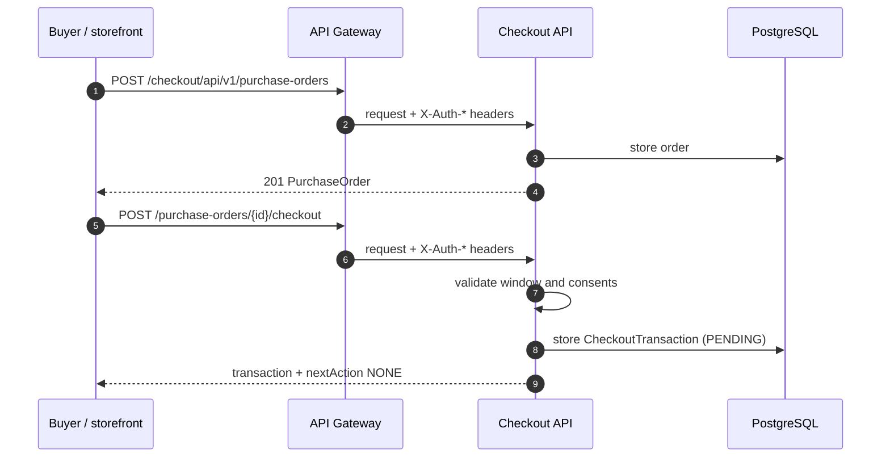

# Checkout

## Overview
Checkout is a whitelabel order and checkout layer: an API for purchase orders, customers and checkout transactions, and a brandable Vue 3 checkout page. It validates the order (currency, tax, validity window, required consents) before it records the buyer's checkout transaction.

> **Current scope.** Checkout records the checkout transaction as `PENDING` and returns `nextAction: NONE`. It does not call the Payment Gateway yet, and it does not publish events yet.

## Capabilities

| Capability | Description |
|------------|-------------|
| **Purchase orders** | Items, currency, tax, an optional customer and an optional validity window (`startsAt`, `endsAt`). |
| **Customers** | Create, read and update customer records. |
| **Checkout transactions** | A transaction per checkout, with billing and shipping details, consents and the chosen payment method. |
| **Validation** | Currency, tax rate, time range, extras and required consents are checked before a transaction is created. |
| **Multi-tenant** | Tenant and scopes come from the trusted gateway headers; every query is tenant-scoped. |
| **Checkout page** | A Vue 3 UI configured at runtime through `env.json`, with i18n. |

## Architecture

Checkout sits behind the API Gateway. The API stores orders in PostgreSQL and asks the central policy engine (Cerbos) whether the caller may act on a resource.



## Quick Start

Checkout is an optional module. Install the platform with the BYO profile of the [installer](../../getting-started/deploy-to-kubernetes.md) and answer **yes** to "Enable Checkout", or run it in the [full local ecosystem](../../getting-started/run-the-full-ecosystem-locally.md).

### Install with Helm

With a cluster and a PostgreSQL database, install the chart (API and checkout page) and point it at the database:

```bash
helm repo add labs64io https://labs64.github.io/labs64.io-helm-charts
helm repo update

helm install my-checkout labs64io/checkout -n labs64io --create-namespace \
  --set global.postgresql.host=postgres.mycompany.internal
```

Database credentials go in a Kubernetes Secret (see the chart's values), and behind the gateway Checkout also needs the central policy engine (the `authz-pdp` chart). See [Deploy to your Kubernetes cluster](../../getting-started/deploy-to-kubernetes.md) and the [chart on Artifact Hub](https://artifacthub.io/packages/helm/labs64io-helm-charts/checkout).

### Try the API with Docker

To try the API without a cluster, run the published image next to PostgreSQL and the policy engine. Only Docker and Git are needed. Authorization policies are generated from the API contract by the build, so the first step produces them once inside a Maven container; the second step runs the published image.

```bash
git clone https://github.com/Labs64/labs64.io-checkout.git && cd labs64.io-checkout

docker run --rm -v "$PWD":/src -w /src/checkout-be maven:3.9-eclipse-temurin-25 \
  mvn -B -q -DskipTests package                      # generates the authorization policies

docker compose -f docker-compose.images.yml up -d    # PostgreSQL, Cerbos and the Checkout API
```

Create an order and check out. The headers stand in for the ones the API Gateway adds after authenticating a caller:

```bash
api() { curl -s -H "X-Auth-User: demo-user" -H "X-Auth-Tenant: demo" -H "X-Request-ID: demo" \
  -H "X-Auth-Scopes: purchase-order:read,purchase-order:write,purchase-order:checkout,checkout-transaction:read" \
  -H "Content-Type: application/json" "$@"; }

# 1. A purchase order: one item, 30.00 USD
ORDER=$(api -X POST localhost:8080/purchase-orders -d '{
  "currency": "USD",
  "items": [{"name": "Widget Pro", "sku": "WIDGET-PRO", "quantity": 1, "price": 3000}]
}' | grep -o '"id":"[^"]*"' | head -1 | cut -d'"' -f4)

# 2. The buyer checks out
api -X POST localhost:8080/purchase-orders/$ORDER/checkout -d '{
  "paymentMethod": "STRIPE", "consents": {}, "extra": {},
  "billingInfo": {"firstName": "Jane", "lastName": "Doe", "email": "jane.doe@example.com",
                  "country": "US", "city": "San Francisco", "address1": "123 Market St", "postalCode": "94105"}
}' | grep -o '"status":"[A-Z]*"\|"nextAction":{"type":"[A-Z]*"'
```

```text
"status":"PENDING"
"nextAction":{"type":"NONE"
```

The order is validated and a checkout transaction exists in `PENDING`. Swagger UI is at <http://localhost:8080/swagger-ui.html>. Clean up with `docker compose -f docker-compose.images.yml down -v`.

This is an evaluation setup without an API Gateway: do not expose port 8080. The checkout **page** needs the gateway in front of the API, so it comes with the installer's BYO profile or the full local ecosystem.

### Build from source

Needs Docker with Compose v2, JDK 25 and Maven 3.6.3+, and Node for the page:

```bash
cd checkout-be
mvn -B clean package -DskipTests                       # build the API and generate the policies
docker compose -f docker-compose.dev.yml up -d         # PostgreSQL, Cerbos and the API from your jar

cd ../checkout-fe
npm install && npm run dev                              # the checkout page on http://localhost:5173
```

The repository's `AGENTS.md` describes the layout, commands and tests; the [Contributing guide](../../development/contributing.md) covers the workflow.

## Configuration

| Variable | Description | Default |
|----------|-------------|---------|
| `SPRING_DATASOURCE_URL` | PostgreSQL JDBC URL. | none |
| `SPRING_DATASOURCE_USERNAME`, `SPRING_DATASOURCE_PASSWORD` | PostgreSQL credentials. | none |
| `SPRING_FLYWAY_ENABLED` | Apply database migrations at start. | `true` |
| `LABS64_AUTH_AUTHZ_PDPADDRESS` | Central Cerbos policy engine (gRPC), required because order access is checked against it. | none |

The checkout page reads `/config/env.json` at runtime. Mount your own to set the API address:

```json
{ "VITE_API_URL": "https://gateway.example.com/checkout/api/v1" }
```

## REST APIs

All paths are relative to the service; behind the API Gateway they are served under `/checkout/api/v1`.

| Endpoint | Method | Scope | Description |
|----------|--------|-------|-------------|
| `/customers` | `GET`, `POST` | `customer:read`, `customer:write` | List or create customers. |
| `/customers/{id}` | `GET`, `PATCH` | `customer:read`, `customer:write` | Read or update a customer. |
| `/purchase-orders` | `GET`, `POST` | `purchase-order:read`, `purchase-order:write` | List or create purchase orders. |
| `/purchase-orders/{id}` | `GET`, `PATCH` | `purchase-order:read`, `purchase-order:write` | Read or update a purchase order. |
| `/purchase-orders/{id}/checkout` | `POST` | `purchase-order:checkout` | Create the checkout transaction for an order. |
| `/checkout-transactions` | `GET` | `checkout-transaction:read` | List checkout transactions. |
| `/checkout-transactions/{id}` | `GET` | `checkout-transaction:read` | Read one transaction. |

The OpenAPI contract is the source of truth: [`openapi-checkout-v1.yaml`](https://github.com/Labs64/labs64.io-checkout/blob/master/checkout-be/src/main/resources/openapi/openapi-checkout-v1.yaml).

## Events

Checkout does not publish events yet. When it does, they will be delivered to AuditFlow over its HTTP API as a service principal, like the Payment Gateway's.

## Examples

### Creating an order and checking out

```json
POST /purchase-orders
{
  "currency": "USD",
  "items": [{ "name": "Widget Pro", "sku": "WIDGET-PRO", "quantity": 1, "price": 3000 }]
}

POST /purchase-orders/{id}/checkout
{
  "paymentMethod": "STRIPE",
  "consents": {},
  "extra": {},
  "billingInfo": { "firstName": "Jane", "lastName": "Doe", "email": "jane.doe@example.com",
                   "country": "US", "city": "San Francisco", "address1": "123 Market St", "postalCode": "94105" }
}
```

The response carries the `transaction` (status `PENDING`) and `nextAction` (`NONE`). Send `consents` and `extra` explicitly: leaving them out currently returns `500`.

### Using Checkout from an AI agent

Checkout turns a basket into a validated, auditable order that an agent can create and finalize with plain REST.

- **Machine-readable contract.** The OpenAPI v1 spec is served by the running API; generate a client or tool definition from it.
- **Least privilege.** Operations require scopes such as `purchase-order:write` and `purchase-order:checkout`; give an agent only what its task needs.
- **Send complete bodies.** `consents` and `extra` must be present (use `{}`); omitting them currently returns `500` rather than a validation error.

## Before you go live

- **Put it behind the API Gateway.** The API trusts the `X-Auth-*` headers it receives; without a gateway that authenticates callers, anyone who can reach it can claim any identity.
- **Know the scope.** Checkout records the transaction as `PENDING` and does not hand it to the Payment Gateway, so no payment is taken by this module alone.
- **Run the policy engine with matching policies.** Authorization cannot be switched off for this module; regenerate the policies whenever the API contract changes.

## Operations

Checkout needs PostgreSQL for its state and a reachable Cerbos policy engine whose policies were generated from the same API contract version. Back up the database regularly and monitor connection pool metrics through Actuator.

## Troubleshooting

| Symptom | Cause | Resolution |
|---------|-------|------------|
| The service exits at start with `QueryPlanner` missing | The policy engine is not configured | Set `LABS64_AUTH_AUTHZ_PDPADDRESS` and make Cerbos reachable; authorization cannot be switched off for this module. |
| `401 Unauthorized` on every call | Trusted `X-Auth-*` headers missing | Call through the API Gateway, or send `X-Auth-User`, `X-Auth-Tenant`, `X-Auth-Scopes` (comma-separated) and `X-Request-ID`. |
| `403` from Cerbos on a valid token | Policies do not match the running version | Regenerate the policies from the same checkout of the contract (`mvn package`) and reload the policy engine. |
| `500` on `/checkout` | `consents` or `extra` omitted | Send both, using `{}` when there is nothing to record. |
