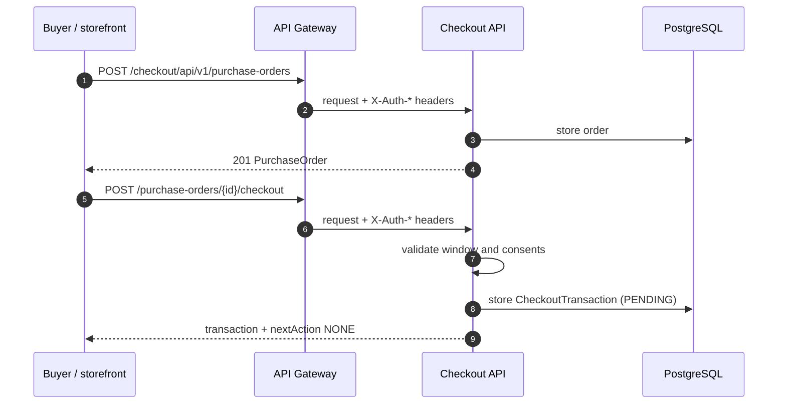

# Checkout

## Overview
Checkout is a whitelabel order and checkout layer: an API for purchase orders, customers and checkout transactions, and a Vue 3 checkout page. It validates the order (currency, tax, validity window, required consents) before it records the buyer's checkout transaction.

Checkout starts at the purchase order. It has no product catalogue, cart or inventory; your storefront or backend creates the order.

> **Scope.** Checkout records the checkout transaction as `PENDING` and returns `nextAction: NONE`. It does not call the [Payment Gateway](../payment-gateway/index.md), so your own system creates and pays the payment there. No Checkout operation changes a transaction's status after that.

## Capabilities

| Capability | Description |
|------------|-------------|
| **Purchase orders** | Items, currency, tax, an optional customer and an optional validity window (`startsAt`, `endsAt`). |
| **Customers** | Create, read and update customer records. |
| **Checkout transactions** | A transaction per checkout, with billing and shipping details, consents and the chosen payment method. |
| **Validation** | Currency, tax rate, time range, extras and required consents are checked before a transaction is created. |
| **Multi-tenant** | Tenant and scopes come from the trusted gateway headers; every query is tenant-scoped. |
| **Policy-filtered lists** | The central policy engine decides which purchase orders a caller may list, and Checkout applies that decision as a database filter. |
| **Checkout page** | A Vue 3 page at `/checkout/{orderId}` that shows the order with billing, shipping and payment-method forms. It reads its settings from `env.json` at runtime, so one image runs in every environment. It has English, German and Ukrainian translations and picks the browser's language. |
| **OpenAPI-first** | The OpenAPI contract is the source of truth. The build generates the server interfaces and the authorization policies from it. |

## Architecture

Checkout sits behind the API Gateway. The API stores orders in PostgreSQL and asks the central policy engine (Cerbos) whether the caller may act on a resource.

| Part | Stack | Role |
|---|---|---|
| `checkout-be` | Java 25, Spring Boot 4 | The REST API for orders, customers, consents and checkout transactions. Flyway migrates its PostgreSQL schema. |
| `checkout-fe` | Vue 3, Vite, nginx | The checkout page at `/checkout/{orderId}`, published as the `labs64/checkout-ui` image. |



## Quick Start

Checkout is an optional module. To see the API and the checkout page behind the gateway, run the [full local ecosystem](../../getting-started/run-the-full-ecosystem-locally.md), which builds Checkout from source and publishes its routes. The [installer](../../getting-started/deploy-to-kubernetes.md)'s "Enable Checkout" question installs the chart without its gateway routes and without the policy engine address, so Checkout is not reachable that way. To install the chart yourself, see [Install with Helm](#install-with-helm).

### Install with Helm

The `checkout` chart installs the API and the checkout page. It bundles no data store, so you bring PostgreSQL (database `checkout`) and the central policy engine. Save your settings as `checkout-values.yaml`:

```yaml
global:
  postgresql:
    host: postgres.mycompany.internal

gateway:
  enabled: true          # publish the API routes on the API Gateway

env:
  - name: LABS64_AUTH_AUTHZ_PDPADDRESS
    value: "authz-pdp:3593"

secrets:
  data:
    SPRING_DATASOURCE_USERNAME: <your-db-username>
    SPRING_DATASOURCE_PASSWORD: <your-db-password>

ui:
  gateway:
    enabled: true        # publish the checkout page at /checkout
  application:
    runtimeEnv:
      env:
        VITE_API_URL: https://gateway.example.com/checkout/api/v1
```

```bash
helm repo add labs64io https://labs64.github.io/labs64.io-helm-charts
helm repo update

helm install authz-pdp labs64io/authz-pdp -n labs64io --create-namespace
helm install my-checkout labs64io/checkout -n labs64io -f checkout-values.yaml
```

A plain `helm install` without the policy engine address, the database credentials and `gateway.enabled` gives a service that denies every request. Authorization cannot be switched off for this module. A pre-install Job creates the database when it is missing and runs the migrations. Keep the passwords out of version control, or set `externalSecrets.enabled` to read them through External Secrets Operator. A commented production example is in the Helm charts repository at [`overrides/checkout/values.prod-example.yaml`](https://github.com/Labs64/labs64.io-helm-charts/blob/master/overrides/checkout/values.prod-example.yaml). See [Deploy to your Kubernetes cluster](../../getting-started/deploy-to-kubernetes.md) and the [chart on Artifact Hub](https://artifacthub.io/packages/helm/labs64io-helm-charts/checkout).

### Try the API with Docker

To try the API without a cluster, run the published image next to PostgreSQL and the policy engine. Only Docker and Git are needed. Authorization policies are generated from the API contract by the build, so the first step produces them once inside a Maven container, which takes about two minutes the first time; the second step runs the published image.

```bash
git clone https://github.com/Labs64/labs64.io-checkout.git && cd labs64.io-checkout

docker run --rm -v "$PWD":/src -w /src/checkout-be maven:3.9-eclipse-temurin-25 \
  mvn -B -q -DskipTests package                      # generates the authorization policies

docker compose -f docker-compose.images.yml up -d    # PostgreSQL, Cerbos and the Checkout API
```

Set `CHECKOUT_VERSION` to a release tag to pin that release; the default is `latest`.

Create an order and check out. The headers stand in for the ones the API Gateway adds after authenticating a caller:

```bash
api() { curl -s -H "X-Auth-User: demo-user" -H "X-Auth-Tenant: demo" -H "X-Request-ID: demo" \
  -H "X-Auth-Scopes: purchase-order:read,purchase-order:write,purchase-order:checkout,checkout-transaction:read" \
  -H "Content-Type: application/json" "$@"; }

# 1. A purchase order: one item, 30.00 USD
ORDER=$(api -X POST localhost:8080/purchase-orders -d '{
  "currency": "USD",
  "items": [{"name": "Widget Pro", "sku": "WIDGET-PRO", "quantity": 1, "price": 3000}]
}' | grep -o '"id":"[^"]*"' | head -1 | cut -d'"' -f4)

# 2. The buyer checks out
api -X POST localhost:8080/purchase-orders/$ORDER/checkout -d '{
  "paymentMethod": "STRIPE", "consents": {}, "extra": {},
  "billingInfo": {"firstName": "Jane", "lastName": "Doe", "email": "jane.doe@example.com",
                  "country": "US", "city": "San Francisco", "address1": "123 Market St", "postalCode": "94105"}
}' | grep -o '"status":"[A-Z]*"\|"nextAction":{"type":"[A-Z]*"'
```

```text
"status":"PENDING"
"nextAction":{"type":"NONE"
```

The order is validated and a checkout transaction exists in `PENDING`. Swagger UI is at <http://localhost:8080/swagger-ui.html>. Clean up with `docker compose -f docker-compose.images.yml down -v`.

This is an evaluation setup without an API Gateway. Anyone who can reach port 8080 can claim any identity, so do not expose it. The checkout **page** needs the gateway in front of the API, so it comes with the installer's BYO profile or the full local ecosystem.

### Build from source

Needs Docker with Compose v2, JDK 25 and Maven 3.6.3+, and Node for the page:

```bash
cd checkout-be
mvn -B clean package -DskipTests                       # build the API and generate the policies
docker compose -f docker-compose.dev.yml up -d         # PostgreSQL, Cerbos and the API from your jar

cd ../checkout-fe
npm install && npm run dev                              # the checkout page on http://localhost:5173
```

The development stack serves the API on port `8010`, which is the address the page uses in development. It turns off the trusted-header check and uses the fixed tenant `t_dev`. The repository's [`AGENTS.md`](https://github.com/Labs64/labs64.io-checkout/blob/master/AGENTS.md) describes the layout, commands and tests; the [Contributing guide](../../development/contributing.md) covers the workflow.

## Configuration

| Variable | Description | Default |
|----------|-------------|---------|
| `POSTGRES_HOST`, `POSTGRES_PORT`, `POSTGRES_DB` | PostgreSQL connection. `SPRING_DATASOURCE_URL` replaces the whole JDBC URL. | `localhost`, `5432`, `checkout` |
| `SPRING_DATASOURCE_USERNAME`, `SPRING_DATASOURCE_PASSWORD` | PostgreSQL credentials. The Helm chart passes them from a Secret. Without them the service falls back to `POSTGRES_USERNAME` and `POSTGRES_PASSWORD`. | `postgres` |
| `SPRING_FLYWAY_ENABLED` | Apply database migrations at start. The Helm chart runs them in its migration Job instead. Set `true` when you run the image yourself. | `false` |
| `LABS64_AUTH_AUTHZ_PDPADDRESS` | Central Cerbos policy engine (gRPC, `host:port`), required because order access is checked against it. | `localhost:3593` |
| `LABS64_AUTH_AUTHZ_MODE` | `ENFORCE` blocks denied requests. `SHADOW` evaluates and logs every decision without blocking, so do not use it in production. | `ENFORCE` |

Purchase orders accept only the currencies listed under `checkout.currency` in the application configuration. The default list is `USD` and `EUR`.

The checkout page reads `/config/env.json` at runtime; the Helm chart writes it from `ui.application.runtimeEnv.env`. Mount your own to set the API address:

```json
{ "VITE_API_URL": "https://gateway.example.com/checkout/api/v1" }
```

## REST APIs

All paths are relative to the service; behind the API Gateway they are served under `/checkout/api/v1`.

| Endpoint | Method | Scope | Description |
|----------|--------|-------|-------------|
| `/customers` | `GET`, `POST` | `customer:read`, `customer:write` | List or create customers. |
| `/customers/{id}` | `GET`, `PATCH` | `customer:read`, `customer:write` | Read or update a customer. |
| `/purchase-orders` | `GET`, `POST` | `purchase-order:read`, `purchase-order:write` | List or create purchase orders. |
| `/purchase-orders/{id}` | `GET`, `PATCH` | `purchase-order:read`, `purchase-order:write` | Read or update a purchase order. |
| `/purchase-orders/{id}/checkout` | `POST` | `purchase-order:checkout` | Create the checkout transaction for an order. |
| `/checkout-transactions` | `GET` | `checkout-transaction:read` | List checkout transactions. |
| `/checkout-transactions/{id}` | `GET` | `checkout-transaction:read` | Read one transaction. |

The OpenAPI contract is the source of truth: [`openapi-checkout-v1.yaml`](https://github.com/Labs64/labs64.io-checkout/blob/master/checkout-be/src/main/resources/openapi/openapi-checkout-v1.yaml).

### AI agents

An agent can create an order and check it out with plain REST calls:

- The running service serves its OpenAPI contract at `/v3/api-docs`, and the gateway serves it at `/checkout/v3/api-docs`. An agent can generate a client or tool definitions from it.
- Give the agent's client only the scopes its task needs, for example `purchase-order:write` to create orders and `purchase-order:checkout` to check them out.
- Send `consents` and `extra` in every checkout request, as `{}` when there is nothing to record. Without them the call returns `500`, not a validation error.

[Working with AI agents](../../introduction/ai-agents.md) covers tokens and documentation files for agents in general.

## Events

Checkout publishes no events.

## Examples

### Creating an order and checking out

```json
POST /purchase-orders
{
  "currency": "USD",
  "items": [{ "name": "Widget Pro", "sku": "WIDGET-PRO", "quantity": 1, "price": 3000 }]
}

POST /purchase-orders/{id}/checkout
{
  "paymentMethod": "STRIPE",
  "consents": {},
  "extra": {},
  "billingInfo": { "firstName": "Jane", "lastName": "Doe", "email": "jane.doe@example.com",
                   "country": "US", "city": "San Francisco", "address1": "123 Market St", "postalCode": "94105" }
}
```

The response carries the `transaction` (status `PENDING`) and `nextAction` (`NONE`). Send `consents` and `extra` explicitly: leaving them out currently returns `500`.

## Operations

Checkout needs PostgreSQL for its state and a reachable Cerbos policy engine whose policies were generated from the same API contract version. Back up the database regularly and monitor connection pool metrics through Actuator.

The checkout page loads the order with `GET /purchase-orders/{id}` and sends no access token, while the API Gateway requires a token with the `purchase-order:read` scope for that call. The page does not call `POST /purchase-orders/{id}/checkout`, its payment methods are a fixed list of `PAYPAL` and `STRIPE`, and its brand name and logo are built into the image. Your storefront or backend calls the checkout operation.

### Before you go live

- The service trusts the `X-Auth-*` headers it receives. Run it only behind the API Gateway, and do not expose its port otherwise.
- A checkout transaction records the buyer's intent, not a payment. Take money only through the Payment Gateway, and fulfil an order only after its payment transaction is `SUCCESS`.
- Keep `labs64.tenant.default` empty. A value there gives every request without a tenant header that tenant.

## Troubleshooting

| Symptom | Cause | Resolution |
|---------|-------|------------|
| The service exits at start with `QueryPlanner` missing | The policy engine is not configured | Set `LABS64_AUTH_AUTHZ_PDPADDRESS` and make Cerbos reachable; authorization cannot be switched off for this module. |
| `401 Unauthorized` on every call | Trusted `X-Auth-*` headers missing | Call through the API Gateway, or send `X-Auth-User`, `X-Auth-Tenant`, `X-Auth-Scopes` (comma-separated) and `X-Request-ID`. |
| `403` from Cerbos on a valid token | Policies do not match the running version | Regenerate the policies from the same checkout of the contract (`mvn package`) and reload the policy engine. |
| `500` on `/checkout` | `consents` or `extra` omitted | Send both, using `{}` when there is nothing to record. |
| `400 VALIDATION_ERROR` on `/checkout` | The order is outside its `startsAt` to `endsAt` window, or a required consent is not accepted | Check the order's window, and send every required consent as `true` in `consents`. |

## Next steps

| I want to | Read |
|---|---|
| Call the API from my storefront | [REST APIs](#rest-apis) |
| Take the payment for an order | [Payment Gateway](../payment-gateway/index.md) |
| Compare the ways to run Labs64.IO | [Choose a deployment path](../../getting-started/choose-a-deployment-path.md) |
| Fix a first run that does not work | [Troubleshooting your first run](../../getting-started/troubleshooting.md) |

If your question is not answered, [open an issue](https://github.com/Labs64/labs64.io-checkout/issues).
