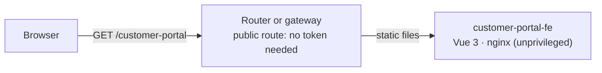

# Customer Portal

## Overview
Customer Portal is the customer-facing single-page app of the platform: a Vue 3 application built into static files and served by unprivileged nginx.

> **Current scope.** The repository ships the front-end shell, with a home page and a shopping-cart page. A Java backend (`customer-portal-be`) is planned but not implemented, so the portal does not yet call a Labs64.IO API on its own.

## Why Customer Portal?

Customers want to manage their account without writing to support, and the page that lets them should be deployed and secured like the rest of your platform. Customer Portal is the front-end shell for that.

1. **One static image.** A multi-stage build produces files served by unprivileged nginx, so it runs on any cluster or static host.
2. **Fits the edge.** The app is static files served by unprivileged nginx and does no authentication itself. It is meant to be served on a public route that needs no token, so it must not contain secrets or customer data. In the reference Labs64.IO environment the chart exposes it as a public route.
3. **Built to be composed.** Module federation support lets micro-frontends plug into the portal.

**A good fit if**

- You are on the Labs64.IO platform and want a customer-facing app that deploys the same way as the services.
- You prefer a static, cache-friendly front end served on a public route, with no authentication in the app.
- You want a Vue 3 starting point you can extend, with unit and end-to-end tests already wired.

**Probably not what you need if**

- You need a finished self-service product today: this is a shell with a home page and a cart page, and the backend is planned.
- You need server-side rendering or a CMS.

## Capabilities

| Capability | Description |
|------------|-------------|
| **Static, one image** | A multi-stage build produces files served by unprivileged nginx; the image runs on any cluster or static host. |
| **Modern front end** | Vue 3 (Composition API), Vite, Pinia, TypeScript, Bootstrap 5 and Bootstrap Vue Next. |
| **Composable** | Module federation (`@originjs/vite-plugin-federation`) is available for composing micro-frontends, which plug into the portal. |
| **Tested** | Unit tests with Vitest, end-to-end tests with Playwright, linted with ESLint. |

## What is here today

| In the repository | Planned |
|---|---|
| Vue 3 + Vite + TypeScript single-page app with a home page and a shopping-cart page | `customer-portal-be`, a Java backend |
| Multi-stage Docker build served by unprivileged nginx | Account, subscription and order views backed by the platform APIs |
| Unit tests (Vitest), end-to-end tests (Playwright), ESLint | Runtime configuration through a mounted file |
| Helm chart and a published `edge` image | A tagged release image |

## Architecture

The portal is a single-page app served by nginx. It does no authentication, so any router or gateway can expose it on a public route that needs no token. In the reference Labs64.IO environment the chart publishes `/customer-portal` on the shared gateway as a public route, which skips the Auth Gateway check and the rate limit.



## Quick Start

Install the platform with the BYO profile of the [installer](../../getting-started/deploy-to-kubernetes.md) and answer **yes** to "Enable Customer Portal", or run the [full local ecosystem](../../getting-started/run-the-full-ecosystem-locally.md) and open `http://gateway.localhost/customer-portal`.

To see the app without a cluster, run the published image. Only the `edge` tag is published today:

```bash
docker run -d --rm --name portal -p 8080:8080 labs64/customer-portal-ui:edge
```

Open <http://localhost:8080> and clean up with `docker rm -f portal`.

### Install with Helm

The portal chart has no backend dependency, so this is the shortest install of any module:

```bash
helm repo add labs64io https://labs64.github.io/labs64.io-helm-charts
helm repo update

helm install my-portal labs64io/customer-portal -n labs64io --create-namespace
```

Put it behind your gateway route at `/customer-portal`. See [Deploy to your Kubernetes cluster](../../getting-started/deploy-to-kubernetes.md) and the [chart on Artifact Hub](https://artifacthub.io/packages/helm/labs64io-helm-charts/customer-portal).

### Build from source

Needs Node and npm (Docker for the image):

```bash
git clone https://github.com/Labs64/labs64.io-customer-portal.git && cd labs64.io-customer-portal/customer-portal-fe
npm install
npm run dev          # hot-reload dev server on http://localhost:8080
npm run test:unit    # Vitest
npm run test:e2e     # Playwright
npm run lint         # ESLint
docker build -t customer-portal-ui .
```

The repository's `AGENTS.md` describes the layout, commands and tests; the [Contributing guide](../../development/contributing.md) covers the workflow.

## Configuration

The chart has no backend dependency; enable the UI with `ui.enabled`. The nginx image listens on port `8080` as an unprivileged user.

## REST APIs

The Customer Portal is a client, not a server. It does not expose REST APIs.

## Events

The Customer Portal does not publish events.

## Operations

The portal is stateless static content: scale it with replicas and cache it at the edge. The route is public and the app does not authenticate visitors, so everything in the image is visible to anyone who can reach it. Don't bake customer data into the image. Load it from an API that checks the caller's token.

## Troubleshooting

| Symptom | Cause | Resolution |
|---------|-------|------------|
| `ImagePullBackOff` | No release tag of `labs64/customer-portal-ui` exists yet | Use the `edge` tag, or build the image from the repository. |
| `404` at `/customer-portal` | The route is not installed | Enable the module and its gateway route in the chart values. |
