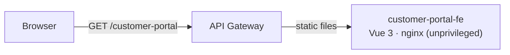

# Customer Portal

## Overview
Customer Portal is the customer-facing single-page app of the platform: a Vue 3 application built into static files and served by unprivileged nginx behind the API Gateway.

> **Current scope.** The repository ships the front-end shell, with a home page and a shopping-cart page. A Java backend (`customer-portal-be`) is planned but not implemented, so the portal does not yet call a Labs64.IO API on its own.

## Capabilities

| Capability | Description |
|------------|-------------|
| **Static, one image** | A multi-stage build produces files served by unprivileged nginx; the image runs on any cluster or static host. |
| **Edge authentication** | Sign-in is handled at the API Gateway (OIDC/JWT); the app itself is static. |
| **Modern front end** | Vue 3 (Composition API), Vite, Pinia, TypeScript, Bootstrap 5 and Bootstrap Vue Next. |
| **Composable** | Module federation (`@originjs/vite-plugin-federation`) is available for micro-frontends. |
| **Tested** | Unit tests with Vitest, end-to-end tests with Playwright, linted with ESLint. |

## Architecture

The portal is a single-page app served by nginx. The API Gateway authenticates the caller and routes `/customer-portal` to it.



## Quick Start

Install the platform with the BYO profile of the [installer](../../getting-started/deploy-to-kubernetes.md) and answer **yes** to "Enable Customer Portal", or run the [full local ecosystem](../../getting-started/run-the-full-ecosystem-locally.md) and open `http://gateway.localhost/customer-portal`.

To see the app without a cluster, run the published image. Only the `edge` tag is published today:

```bash
docker run -d --rm --name portal -p 8080:8080 labs64/customer-portal-ui:edge
```

Open <http://localhost:8080> and clean up with `docker rm -f portal`.

## Configuration

The chart has no backend dependency; enable the UI with `ui.enabled`. The nginx image listens on port `8080` as an unprivileged user.

## REST APIs

The Customer Portal is a client, not a server. It does not expose REST APIs.

## Events

The Customer Portal does not publish events.

## Operations

The portal is stateless static content: scale it with replicas and cache it at the edge. Because authentication happens at the gateway, expose it only through the gateway route.

## Troubleshooting

| Symptom | Cause | Resolution |
|---------|-------|------------|
| `ImagePullBackOff` | No release tag of `labs64/customer-portal-ui` exists yet | Use the `edge` tag, or build the image from the repository. |
| `404` at `/customer-portal` | The route is not installed | Enable the module and its gateway route in the chart values. |
