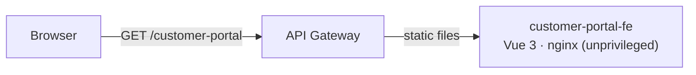

# Customer Portal

## Overview
Customer Portal is the customer-facing single-page app of the platform: a Vue 3 application built into static files and served by unprivileged nginx behind the API Gateway.

> **Scope.** The repository ships the front-end shell, with a home page and a shopping-cart page. The portal has no backend of its own and calls no Labs64.IO API. It renders in the browser, with no server-side rendering.

## Capabilities

| Capability | Description |
|------------|-------------|
| **Static, one image** | A multi-stage build produces files served by unprivileged nginx; the image runs on any cluster or static host. |
| **Modern front end** | Vue 3 (Composition API), Vite, Pinia, TypeScript, Bootstrap 5 and Bootstrap Vue Next. |
| **Composable** | The app is a module federation host (`@originjs/vite-plugin-federation`) and shares `vue` and `pinia` with its remotes. The shopping-cart page loads `ShoppingCartPage` from a remote `ecommerce` application. |
| **Tested** | Unit tests with Vitest, end-to-end tests with Playwright, linted with ESLint. |

## Architecture

The portal is a single-page app served by nginx. The API Gateway routes `/customer-portal` to it as a public route, so visitors need no token.



## Quick Start

To see the portal behind the gateway, run the [full local ecosystem](../../getting-started/run-the-full-ecosystem-locally.md), which builds the portal from source, and open `http://gateway.localhost/customer-portal`. The [installer](../../getting-started/deploy-to-kubernetes.md)'s "Enable Customer Portal" question installs the chart with its default image tag, which has no published image, and without the gateway route, so the pod ends in `ImagePullBackOff`. To install the chart yourself, see [Install with Helm](#install-with-helm).

To see the app without a cluster, run the published image. Only the `edge` tag is published today:

```bash
docker run -d --rm --name portal -p 8080:8080 labs64/customer-portal-ui:edge
```

Open <http://localhost:8080> and clean up with `docker rm -f portal`.

### Install with Helm

The portal chart has no backend dependency, so this is the shortest install of any module. Install it next to the API Gateway and publish its route:

```bash
helm repo add labs64io https://labs64.github.io/labs64.io-helm-charts
helm repo update

helm install my-portal labs64io/customer-portal -n labs64io --create-namespace \
  --set ui.image.tag=edge \
  --set ui.gateway.enabled=true
```

`ui.image.tag=edge` is needed because the chart's default tag, its `appVersion`, has no published image. `ui.gateway.enabled` publishes the route `/customer-portal` on the shared gateway `labs64io-gateway` in the `tools` namespace. See [Deploy to your Kubernetes cluster](../../getting-started/deploy-to-kubernetes.md) and the [chart on Artifact Hub](https://artifacthub.io/packages/helm/labs64io-helm-charts/customer-portal).

### Build from source

Needs Node and npm (Docker for the image):

```bash
git clone https://github.com/Labs64/labs64.io-customer-portal.git && cd labs64.io-customer-portal/customer-portal-fe
npm install
npm run dev          # hot-reload dev server on http://localhost:8080
npm run test:unit    # Vitest
npm run test:e2e     # builds the app, then runs Playwright
npm run lint         # ESLint, which also fixes what it can
docker build -t customer-portal-ui .
```

Run the unit tests, the end-to-end tests and the linter before you propose a change. The repository's [`AGENTS.md`](https://github.com/Labs64/labs64.io-customer-portal/blob/master/AGENTS.md) describes the layout, commands and tests; the [Contributing guide](../../development/contributing.md) covers the workflow.

## Configuration

The chart has no backend dependency; enable the UI with `ui.enabled`. The nginx image listens on port `8080` as an unprivileged user.

The app reads no runtime configuration, so the chart's `ui.application.runtimeEnv` values do not change it. The address of the `ecommerce` remote is set at build time in `customer-portal-fe/vite.config.ts` and points to `http://localhost:8081/assets/remoteEntry.js`. Change it and rebuild the image to load your own remote. Without a reachable remote, the shopping-cart page shows an error message.

## REST APIs

The Customer Portal is a client, not a server. It does not expose REST APIs.

## Events

The Customer Portal does not publish events.

## Operations

The portal is stateless static content: scale it with replicas and cache it at the edge. The gateway route is public and does not authenticate visitors, so everything in the image is visible to anyone who can reach the route. Add authentication before you put customer data behind the portal.

## Troubleshooting

| Symptom | Cause | Resolution |
|---------|-------|------------|
| `ImagePullBackOff` | No release tag of `labs64/customer-portal-ui` exists yet | Use the `edge` tag, or build the image from the repository. |
| `404` at `/customer-portal` | The route is not installed | Enable the module and its gateway route in the chart values. |

## Next steps

| I want to | Read |
|---|---|
| Run it inside the whole platform | [Run the full ecosystem locally](../../getting-started/run-the-full-ecosystem-locally.md) |
| Deploy it behind my gateway | [Deploy to your Kubernetes cluster](../../getting-started/deploy-to-kubernetes.md) |
| Compare the ways to run Labs64.IO | [Choose a deployment path](../../getting-started/choose-a-deployment-path.md) |
| Fix a first run that does not work | [Troubleshooting your first run](../../getting-started/troubleshooting.md) |

If your question is not answered, [open an issue](https://github.com/Labs64/labs64.io-customer-portal/issues).
