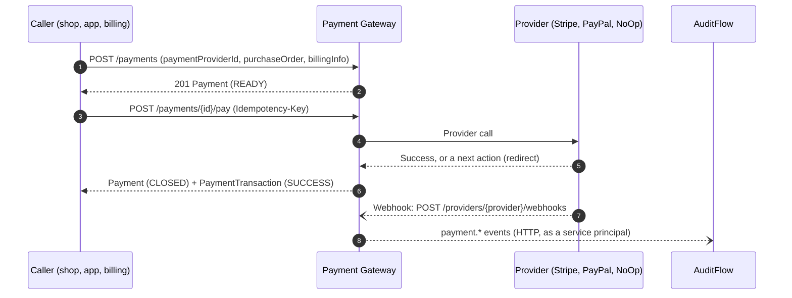

# Payment Gateway

## Overview
Payment Gateway puts one REST API in front of every payment provider (PSP). A shop, app or billing service creates a payment and pays it; Payment Gateway routes it to the tenant's configured provider, normalizes the result and keeps the call safe to retry. Stripe, PayPal and a NoOp test provider ship in the box, and a new provider is a new module behind the provider SPI.

Payment Gateway is the payment API layer only. It has no storefront, no billing UI for subscriptions and no invoicing.

## Capabilities

| Capability | Description |
|------------|-------------|
| **Provider abstraction** | One contract for Stripe, PayPal, NoOp and any provider you add through the SPI. |
| **Idempotent payments** | `POST /payments/{id}/pay` with an `Idempotency-Key` returns the original transaction on replay; it never charges twice. |
| **One result shape** | The gateway maps every provider's responses and webhooks to the same payment and transaction states, so a caller handles a Stripe, PayPal or NoOp result with the same code. |
| **Per-tenant providers** | Each tenant enables providers and holds their credentials; one deployment serves many merchants. |
| **Hosted checkout** | For Stripe and PayPal, `pay` returns a redirect to the provider's hosted checkout. The gateway handles the browser return, the cancel and the webhook. |
| **Webhooks and returns** | PSP webhooks and browser returns are handled per provider. Each provider verifies the PSP signature before a webhook can change a transaction, and a terminal transaction is never overwritten by a late event. |
| **Safe concurrency** | When a browser return and a webhook arrive at the same time, the gateway updates the transaction under a database row lock and applies only the first terminal result. |
| **Recurring payments** | A payment can carry a recurrence rule (`DURATION` or `CRON`) when the provider's payment definition allows recurring payments. |
| **Lifecycle events** | `payment.created`, `payment.finalized` and `payment.closed` can be published to AuditFlow. |
| **OpenAPI-first** | The OpenAPI contract is the source of truth. The build generates the shared models, the server interfaces and the authorization policies from it. |

## Architecture

Payment Gateway sits behind the API Gateway, which authenticates the caller and passes the tenant and scopes as trusted headers. It stores payments in PostgreSQL, uses Redis for idempotency keys and calls the provider through the SPI.




The repository is split into three Maven modules:

| Module | Stack | Role |
|---|---|---|
| `payment-gateway-api` | Java 17, OpenAPI | Canonical contract and validated shared models, published as `io.labs64:payment-gateway-api` |
| `payment-gateway-be` | Java 25, Spring Boot 4 | REST API, idempotency, webhooks, provider registry |
| `payment-gateway-providers` | Java 25 | The provider SPI (`providers-spi`) and one module per PSP (`noop`, `paypal`, `stripe`) |

### Resource model

| Resource | Owner | What it is |
|---|---|---|
| Payment definition | The deployment | A provider that the deployment offers, with its supported currencies and countries and whether it allows recurring payments. `GET /payment-definitions` lists the enabled ones without authentication. |
| Payment provider | A tenant | The tenant's activation of one definition: an `active` flag and the PSP configuration, such as API keys and the webhook secret. |
| Payment | A tenant | What is being paid: the purchase order, billing and shipping data. The gateway creates it as `READY` and sets `CLOSED` when a one-time payment succeeds or when you close it. A payment with a `recurrence` rule has type `RECURRING`, otherwise `ONE_TIME`. |
| Payment transaction | A tenant | One attempt to pay. It starts as `PENDING` and ends as `SUCCESS` or `FAILED`. A new `pay` call creates a new transaction. |

A transaction stays `PENDING` while the customer completes a hosted checkout, and also when the gateway cannot get a definite answer from the PSP. `statusDetails.code` then says which case applies, for example `AWAITING_CUSTOMER`, `PROVIDER_UNAVAILABLE` or `PROVIDER_AUTHENTICATION_FAILED`. A definite decline is `FAILED`, returned with HTTP `200`.

A successful one-time payment becomes `CLOSED`. A recurring payment stays `READY` after each successful transaction. The gateway does not schedule renewals itself, so your application calls `pay` for each one.

### Provider modules

Each PSP is a separate Maven module under `payment-gateway-providers/` that implements the provider SPI from `providers-spi`. The Payment Gateway image contains the `stripe`, `paypal` and `noop` modules, and the gateway finds every provider module on its classpath at startup. The [Stripe](./stripe/index.md) and [PayPal](./paypal/index.md) pages describe the provider configuration, webhooks and checkout flow of each PSP.

## Quick Start

The Payment Gateway is installed by the [Quickstart](../../getting-started/quickstart.md) and by the [full local ecosystem](../../getting-started/run-the-full-ecosystem-locally.md). With a token from either guide, list the providers configured for your tenant:

```bash
curl -s -H "Authorization: Bearer $TOKEN" \
  http://localhost:8000/payment-gateway/api/v1/payment-providers
```

### Install with Helm

The `payment-gateway` chart installs the service on its own. It bundles no data stores, so you bring PostgreSQL, a Redis-compatible store and the central policy engine. Save your settings as `payment-gateway-values.yaml`:

```yaml
global:
  postgresql:
    host: postgres.internal.example.com   # database payment_gateway
  redis:
    host: redis.internal.example.com

gateway:
  enabled: true          # publish the routes on the API Gateway

env:
  - name: LABS64_AUTH_AUTHZ_PDPADDRESS
    value: "authz-pdp:3593"

secrets:
  data:
    SPRING_DATASOURCE_USERNAME: <your-db-username>
    SPRING_DATASOURCE_PASSWORD: <your-db-password>
    SPRING_DATA_REDIS_PASSWORD: <your-redis-password>
```

```bash
helm repo add labs64io https://labs64.github.io/labs64.io-helm-charts
helm repo update

helm install authz-pdp labs64io/authz-pdp -n labs64io --create-namespace
helm install my-payments labs64io/payment-gateway -n labs64io -f payment-gateway-values.yaml
```

The `authz-pdp` chart runs Cerbos with the policies of every module. Without `LABS64_AUTH_AUTHZ_PDPADDRESS`, the service looks for the policy engine at `localhost:3593` and denies every request. A pre-install Job creates the database when it is missing and runs the migrations before the service starts. Keep the passwords out of version control, or set `externalSecrets.enabled` to read them through External Secrets Operator. The [`preflight`](../../getting-started/deploy-to-kubernetes.md#2-check-your-infrastructure-before-you-install) chart checks PostgreSQL and Redis from inside your cluster before you install. A commented production example is in the Helm charts repository at [`overrides/payment-gateway/values.prod-example.yaml`](https://github.com/Labs64/labs64.io-helm-charts/blob/master/overrides/payment-gateway/values.prod-example.yaml). See [Deploy to your Kubernetes cluster](../../getting-started/deploy-to-kubernetes.md) and the [chart on Artifact Hub](https://artifacthub.io/packages/helm/labs64io-helm-charts/payment-gateway).

### Try a payment with Docker

To see a payment end to end without a cluster, run the published image with PostgreSQL and Valkey next to it. Only Docker and Git are needed, and there is nothing to build:

```bash
git clone https://github.com/Labs64/labs64.io-payment-gateway.git && cd labs64.io-payment-gateway
docker compose -f docker-compose.images.yml up -d
```

Set `PAYMENT_GATEWAY_VERSION` to a release tag to pin that release; the default is `latest`. Once the stack is healthy (about 30 seconds), pay for an order. The built-in NoOp provider succeeds without a PSP account, and the headers stand in for the ones the API Gateway adds after authenticating a caller:

```bash
api() { curl -s -H "X-Auth-User: demo-user" -H "X-Auth-Tenant: demo" -H "X-Request-ID: demo" \
  -H "X-Auth-Scopes: payment-provider:read,payment-provider:write,payment:read,payment:write,payment:pay,payment-transaction:read" \
  -H "Content-Type: application/json" "$@"; }
id() { grep -o '"id":"[^"]*"' | head -1 | cut -d'"' -f4; }

# 1. Enable the NoOp provider for this tenant
PROVIDER=$(api -X POST localhost:8080/payment-providers -d '{"provider":"noop","active":true}' | id)

# 2. Create a payment for a 30.00 USD order
PAYMENT=$(api -X POST localhost:8080/payments -d '{
  "paymentProviderId": "'$PROVIDER'",
  "purchaseOrder": {"currency":"USD","netAmount":3000,"taxAmount":0,"grossAmount":3000,
                    "items":[{"name":"Widget Pro","sku":"WIDGET-PRO","price":3000,"quantity":1}]},
  "billingInfo": {"firstName":"Jane","lastName":"Doe","email":"jane.doe@example.com",
                  "country":"US","city":"San Francisco","address1":"123 Market St","postalCode":"94105"}
}' | id)

# 3. Pay it twice with the same Idempotency-Key
for i in 1 2; do
  api -X POST localhost:8080/payments/$PAYMENT/pay -H "Idempotency-Key: order-1001" \
    | grep -o '"status":"[A-Z]*"' | tr '\n' ' '; echo
done

# 4. How many transactions were created?
api "localhost:8080/payment-transactions?paymentId=$PAYMENT" | grep -o '"totalItems":[0-9]*'
```

```text
"status":"CLOSED" "status":"SUCCESS"
"status":"CLOSED" "status":"SUCCESS"
"totalItems":1
```

You paid **twice** and were charged **once**: the replay returned the original transaction. The payment is `CLOSED`, the transaction `SUCCESS`. Swagger UI is at <http://localhost:8080/swagger-ui/index.html>; clean up with `docker compose -f docker-compose.images.yml down -v`.

That stack runs without an API Gateway and with authorization off. Anyone who can reach port 8080 can claim any identity, so do not expose it.

The repository also has a [NoOp flow notebook and a Stripe and PayPal demo runbook](https://github.com/Labs64/labs64.io-payment-gateway/tree/master/examples). The runbook takes one token through a Stripe card payment and a PayPal sandbox payment on a local cluster. For a real PSP, follow [Stripe](./stripe/index.md) or [PayPal](./paypal/index.md).

### Build from source

Needs Docker with Compose v2, JDK 25 and Maven 3.6.3+:

```bash
mvn -B clean package -DskipTests -pl payment-gateway-be -am   # build the backend and its modules
cd payment-gateway-be && cp .env.example .env
docker compose -f docker-compose.yml -f docker-compose.app.yml up -d --build
```

This starts PostgreSQL, Valkey, Cerbos with the policies that the build generated, and the service built from your checkout on port `8080`. Authorization is on, so the `api` calls above work unchanged and a missing scope returns `403`. The repository's [`AGENTS.md`](https://github.com/Labs64/labs64.io-payment-gateway/blob/master/AGENTS.md) describes the layout, commands and tests, and `CONTRIBUTING.md` covers pull requests. To add a payment provider, see [Extend](#extend).

## Configuration

### Service

| Variable | Description | Default |
|----------|-------------|---------|
| `SPRING_PROFILES_ACTIVE` | `local` adds the fallback tenant `t_dev` for a run without the API Gateway. Leave it unset in a deployment. | none |
| `DB_HOST`, `DB_PORT`, `DB_NAME` | PostgreSQL connection. | `localhost`, `5432`, `paymentgateway` |
| `DB_USERNAME`, `DB_PASSWORD` | PostgreSQL credentials. The Helm chart passes them as `SPRING_DATASOURCE_USERNAME` and `SPRING_DATASOURCE_PASSWORD` from a Secret. | `paymentgateway` |
| `REDIS_HOST`, `REDIS_PORT` | Redis-compatible store for idempotency keys. | `localhost`, `6379` |
| `PAYMENT_GATEWAY_PUBLIC_BASE_URL` | Public URL of the gateway API, including the API Gateway prefix. The gateway builds the provider return and cancel URLs from it. | `http://localhost:8080` |
| `PAYMENT_GATEWAY_CHECKOUT_FALLBACK_REDIRECT_URL` | Where the browser goes when a provider rejects a return or cancel callback. | `/` |
| `IDEMPOTENCY_REDIS_TTL` | How long the gateway keeps an idempotency record. | `PT3H` |
| `IDEMPOTENCY_PROCESSING_TIMEOUT` | After this time, a retry with the same key may take over a request that never finished. | `PT5M` |
| `LABS64_AUTH_AUTHZ_PDPADDRESS` | Central Cerbos policy engine (gRPC, `host:port`). | `localhost:3593` |
| `LABS64_AUTH_AUTHZ_MODE` | `ENFORCE` blocks denied requests. `SHADOW` evaluates and logs every decision without blocking, so do not use it in production. | `ENFORCE` |
| `AUDITFLOW_ENABLED` | Publish payment lifecycle events to AuditFlow. | `false` |
| `AUDITFLOW_URL` | AuditFlow base URL, when events are enabled. | none |
| `AUDITFLOW_SOURCE_SYSTEM` | `sourceSystem` of the published events. | `labs64.io-payment-gateway` |
| `AUDITFLOW_RETRY_MAX_ATTEMPTS` | Delivery attempts per event. | `3` |
| `AUDITFLOW_CONNECT_TIMEOUT`, `AUDITFLOW_REQUEST_TIMEOUT` | Timeouts of each AuditFlow call. | `5s`, `10s` |

### Payment definitions

Payment definitions are deployment configuration, under `payment-gateway.payment-definitions` in the application configuration. With the Helm chart, set them under `applicationYaml.payment-gateway.payment-definitions`. Each entry has these fields:

| Field | Description |
|---|---|
| `provider` | Provider identifier: `stripe`, `paypal`, `noop` or the identifier of a module you add. |
| `enabled` | `false` hides the provider. Tenants cannot create or use a provider of a disabled definition, and their existing ones drop out of the API. |
| `name`, `description` | Defaults for the tenant provider's display name and description. |
| `recurring` | `true` allows `RECURRING` payments with this provider. |
| `supported-currencies`, `supported-countries` | What the provider supports. `GET /payment-providers?currency=…&country=…` filters on these lists. |

The built-in configuration enables `stripe`, `paypal` and `noop`, all with `recurring: false`. Your own list replaces the built-in list as a whole, so repeat every provider you want to keep.

### Provider credentials

Provider credentials are **not** environment variables. They are part of the tenant's provider configuration, set through the API when the provider is created:

```json
POST /payment-providers
{
  "provider": "stripe",
  "active": true,
  "name": "Stripe",
  "config": { "secretKey": "sk_test_…", "webhookSecret": "whsec_…" }
}
```

`GET /payment-definitions` lists the supported provider identifiers. Each provider declares the `config` fields it accepts. The gateway drops unknown fields and rejects the request when a required field is missing. The `noop` provider accepts no configuration. See [Stripe provider configuration](./stripe/index.md#provider-configuration) and [PayPal provider configuration](./paypal/index.md#provider-configuration) for the fields. Webhook authenticity is verified with the provider's signature, using the secret stored in this configuration.

`PATCH /payment-providers/{id}` merges the `config` fields you send into the stored ones. Responses to `POST`, `PATCH` and `GET /payment-providers/{id}` contain the stored configuration, secrets included, in clear text. List responses never contain it.

## REST APIs

All paths are relative to the service; behind the API Gateway they are served under `/payment-gateway/api/v1`.

| Endpoint | Method | Description | Scope |
|----------|--------|-------------|-------|
| `/payment-definitions` | `GET` | Supported providers. | public |
| `/payment-providers` | `GET`, `POST` | List or enable a provider for the tenant. | `payment-provider:read`, `payment-provider:write` |
| `/payment-providers/{id}` | `GET`, `PATCH`, `DELETE` | Read with configuration, update or remove a tenant provider. A provider that has payments cannot be deleted. | `payment-provider:write` |
| `/payments` | `GET`, `POST` | List payments or create one (`READY`). | `payment:read`, `payment:write` |
| `/payments/{id}` | `GET` | Payment status and any pending next action. | `payment:read` |
| `/payments/{id}/pay` | `POST` | Execute the payment. Send an `Idempotency-Key`. For a hosted checkout, send `checkout.returnUrl` and `checkout.cancelUrl`. | `payment:pay` |
| `/payments/{id}/close` | `POST` | Close a payment. | `payment:write` |
| `/payment-transactions` | `GET` | List transactions, filter by `paymentId` and `status`. | `payment-transaction:read` |
| `/payment-transactions/{id}` | `GET` | One transaction. | `payment-transaction:read` |
| `/providers/{provider}/webhooks` | `POST` | Ingress for a provider's webhooks (signature-verified). | public |
| `/providers/{provider}/checkout-sessions/{sessionId}/return` | `GET` | Browser return after an external checkout. | public |
| `/providers/{provider}/checkout-sessions/{sessionId}/cancel` | `GET` | Browser cancel after an external checkout. | public |
| `/checkout-sessions/{sessionId}/confirmation` | `GET` | Confirmation of a finished checkout session, without tenant, billing or PSP data. | public |

Every protected operation also requires a tenant. The OpenAPI contract is the source of truth: [`openapi-payment-gateway-v1.yaml`](https://github.com/Labs64/labs64.io-payment-gateway/blob/master/payment-gateway-api/src/main/resources/openapi/openapi-payment-gateway-v1.yaml).

### AI agents

An agent calls Payment Gateway like any other client, and the contract makes repeated calls safe:

- The running service serves its OpenAPI contract at `/v3/api-docs`, and the gateway serves it at `/payment-gateway/v3/api-docs`. An agent can generate a client or tool definitions from it.
- `GET /payment-definitions` lists the providers the deployment offers, and `GET /payment-providers` lists the ones the tenant has configured.
- Send an `Idempotency-Key` on every `POST /payments/{id}/pay`. An agent that times out and retries with the same key gets the original transaction back, not a second charge.
- Give the agent's client only the scopes its task needs, for example `payment:write` to create payments and `payment:pay` to pay them. Keep `payment-provider:write` away from agents, because it returns the tenant's PSP secrets.

[Working with AI agents](../../introduction/ai-agents.md) covers tokens and documentation files for agents in general.

### Idempotency

The `Idempotency-Key` header is optional, and only `POST /payments/{id}/pay` uses it. Without it, every call is a new payment attempt. With it, the gateway stores the response in Redis under the tenant, the operation and the key:

- A repeated request with the same key and the same body gets the stored response, and the PSP is not called again.
- The same key with a different body returns `409` with `IDEMPOTENCY_CONFLICT`.
- A repeated request while the first one is still running returns `409` with `CONFLICT`.
- The gateway keeps the record for `IDEMPOTENCY_REDIS_TTL`, three hours by default.

### Errors

Every error response has the same shape: `code`, `message`, `timestamp` and an optional `traceId`. The codes are `NOT_FOUND`, `VALIDATION_ERROR`, `CONFLICT`, `INTERNAL_ERROR`, `PSP_ERROR`, `MISSING_TENANT_ID`, `UNAUTHORIZED`, `FORBIDDEN`, `IDEMPOTENCY_CONFLICT` and `PAYMENT_NOT_PAYABLE`. `pay` returns `409 PAYMENT_NOT_PAYABLE` when the payment is not `READY` or its provider is inactive or disabled, and `502 PSP_ERROR` only when it cannot return a transaction at all.

## Events

When `AUDITFLOW_ENABLED` is `true`, Payment Gateway publishes lifecycle events to [AuditFlow](../auditflow/index.md) over its HTTP API, as the `service:payment-gateway` principal with the scope `audit-event:write`. It has no message-broker dependency.

| Event Type | Description |
|------------|-------------|
| `payment.created` | A payment was created. |
| `payment.finalized` | A payment reached a final outcome. |
| `payment.closed` | A payment was closed. |

Each event carries the payment's tenant, and its `extra` field holds the `payment` and, where there is one, the `transaction`. The gateway sends an event after the database commit, in the background. If AuditFlow rejects the event, or cannot be reached within `AUDITFLOW_RETRY_MAX_ATTEMPTS` attempts, the gateway logs the failure and drops the event. The payment itself is not affected. AuditFlow accepts the events only for tenants it has provisioned.

## Examples

### Paying an order

```bash
# 1. Enable the NoOp provider for the tenant
POST /payment-providers
{ "provider": "noop", "active": true }
# -> { "id": "<providerId>", ... }

# 2. Create a payment (201, status READY)
POST /payments
{
  "paymentProviderId": "<providerId>",
  "purchaseOrder": {
    "currency": "USD", "netAmount": 3000, "taxAmount": 0, "grossAmount": 3000,
    "items": [{ "name": "Widget Pro", "sku": "WIDGET-PRO", "price": 3000, "quantity": 1 }]
  },
  "billingInfo": { "firstName": "Jane", "lastName": "Doe", "email": "jane.doe@example.com",
                   "country": "US", "city": "San Francisco", "address1": "123 Market St", "postalCode": "94105" }
}

# 3. Pay it. Replaying with the same key returns the same transaction
POST /payments/{paymentId}/pay          Idempotency-Key: order-1001
# -> payment.status CLOSED, paymentTransaction.status SUCCESS
```

With Stripe or PayPal, step 3 sends the URLs the customer returns to, and the response carries a `nextAction` of type `REDIRECT` with the URL of the hosted checkout:

```json
POST /payments/{paymentId}/pay          Idempotency-Key: order-1001
{ "checkout": { "returnUrl": "https://shop.example.com/paid", "cancelUrl": "https://shop.example.com/cart" } }
```

## Extend

To add a PSP, create a Maven module under `payment-gateway-providers/<name>/` and implement `PaymentProvider` from `providers-spi`. Add the optional interfaces your PSP needs:

| Interface | Implement it when |
|---|---|
| `ProviderConfigSupport` | Tenants store credentials or other settings for the provider. It declares the accepted `config` fields and validates them. |
| `ProviderCheckoutSupport` | The PSP uses a hosted checkout with a browser return and cancel. |
| `ProviderWebhookSupport` | The PSP sends webhooks. The provider must verify the webhook's authenticity and throw `WebhookRejectedException` for one it cannot verify. |

A provider returns a result and never writes gateway state itself. When it cannot tell whether the PSP took the payment, it throws `ProviderExecutionException`, and the gateway keeps the transaction `PENDING`. Register the provider as a Spring bean, as the `stripe` and `paypal` modules do with their auto-configuration, add the module as a dependency of `payment-gateway-be`, add a payment definition for it and build a new image. Use the `noop`, `stripe` and `paypal` modules as references.

To contribute a provider to the project, start from the SPI in [`payment-gateway-providers/providers-spi`](https://github.com/Labs64/labs64.io-payment-gateway/tree/master/payment-gateway-providers/providers-spi) and copy the `noop` module as a template. Run the checks that the repository's `AGENTS.md` lists and open a pull request, as the [Contributing guide](../../development/contributing.md) describes.

## Operations

Payment Gateway stores payments and transactions in PostgreSQL and idempotency keys in Redis; both are required. Because this module handles payment orchestration, keep provider credentials in tenant configuration protected by your access controls.

With `networkPolicy.enabled`, the chart allows egress only to DNS, PostgreSQL, Valkey, AuditFlow and the Cerbos policy engine. Calls to the PSP APIs need an extra egress rule for HTTPS (port 443) in `networkPolicy.extraEgress`.

The service reports its liveness and readiness at `/actuator/health/liveness` and `/actuator/health/readiness`, and its metrics at `/actuator/prometheus`. The image contains the OpenTelemetry Java agent, which sends traces when you turn on observability in the deployment (`observability.enabled` in the chart). The service itself has no tracing configuration.

### Before you go live

- The service trusts the `X-Auth-*` headers it receives. Run it only behind the API Gateway, and do not expose its port otherwise.
- Set `PAYMENT_GATEWAY_PUBLIC_BASE_URL` to the public HTTPS URL of the gateway API, so that PSPs send customers back to it.
- Make `/providers/{provider}/webhooks` and the checkout return and cancel paths reachable from the internet over HTTPS.
- Check that each Stripe provider's `webhookSecret` and each PayPal provider's `webhookId` belong to the webhook endpoint of this environment. With a wrong value, the provider rejects every webhook.
- Disable the `noop` payment definition in production, because it accepts every payment without charging anything.
- Grant `payment-provider:write` only to administrators. It allows reading every stored PSP secret of the tenant in clear text.
- Keep PSP credentials only in the tenant provider configuration, never in a repository, and keep the database encrypted and backed up.
- Allow egress to the PSP APIs your providers call, and nothing more.
- Send an `Idempotency-Key` from every caller of `pay`.
- Test with the PSP's sandbox or test mode first.

## Troubleshooting

| Symptom | Cause | Resolution |
|---------|-------|------------|
| `401 Unauthorized` on every call | The trusted `X-Auth-*` headers are missing or invalid | Call through the API Gateway, or send `X-Auth-User`, `X-Auth-Tenant`, `X-Auth-Scopes` (comma-separated) and `X-Request-ID`. |
| `VALIDATION_ERROR` on `paymentProviderId` | The payment names no provider | Create the provider with `POST /payment-providers` first and pass its `id`. |
| `404` for `/api/v1/...` on a direct call | The `/api/v1` prefix is added by the gateway | Call `/payments` directly, or `/payment-gateway/api/v1/payments` through the gateway. |
| `409 CONFLICT` when creating a payment with `recurrence` | The provider's payment definition has `recurring: false` | Set `recurring: true` on that payment definition, if the provider supports it. |
| `409 IDEMPOTENCY_CONFLICT` on `pay` | The `Idempotency-Key` was used before with a different body | Use a new key for a new payment attempt. |
| `409 PAYMENT_NOT_PAYABLE` on `pay` | The payment is `CLOSED`, or its provider is inactive or disabled | Create a new payment, or activate the provider. |
| Payment fails with the provider | Wrong or missing provider credentials | Check the provider's `config` for the tenant; test with the NoOp provider first. |
| Transaction stays `PENDING` with a `PROVIDER_*` status code | The gateway could not reach the PSP or could not read its answer | Check the PSP credentials and the egress rule to the PSP API. |
| The customer is sent to `localhost:8080` after checkout | `PAYMENT_GATEWAY_PUBLIC_BASE_URL` is not set | Set it to the public URL of the gateway API and restart the service. |
| Webhook does not update state | The provider cannot reach the webhook URL or the signature does not match | Make `/providers/{provider}/webhooks` reachable by the provider and verify the webhook secret. |

## Next steps

| I want to | Read |
|---|---|
| Take real payments with Stripe or PayPal | [Stripe](./stripe/index.md), [PayPal](./paypal/index.md) and the [Stripe and PayPal demo runbook](https://github.com/Labs64/labs64.io-payment-gateway/blob/master/examples/payment-gateway-stripe-paypal-demo.md) |
| Handle provider webhooks and browser returns | [REST APIs](#rest-apis) |
| Follow payments in my audit log | [Events](#events) |
| Add a payment provider | [Extend](#extend) |
| Compare the ways to run Labs64.IO | [Choose a deployment path](../../getting-started/choose-a-deployment-path.md) |
| Fix a first run that does not work | [Troubleshooting your first run](../../getting-started/troubleshooting.md) |

If your question is not answered, [open an issue](https://github.com/Labs64/labs64.io-payment-gateway/issues).
