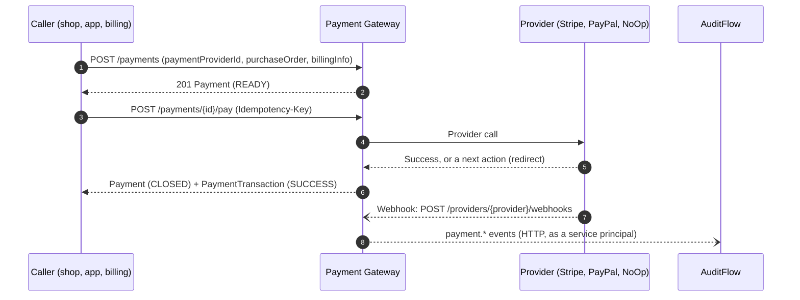

# Payment Gateway

## Overview
Payment Gateway puts one REST API in front of every payment provider (PSP). A shop, app or billing service creates a payment and pays it; Payment Gateway routes it to the tenant's configured provider, normalizes the result and keeps the call safe to retry. Stripe, PayPal and a NoOp test provider ship in the box, and a new provider is a new module behind the provider SPI.

## Capabilities

| Capability | Description |
|------------|-------------|
| **Provider abstraction** | One contract for Stripe, PayPal, NoOp and any provider you add through the SPI. |
| **Idempotent payments** | `POST /payments/{id}/pay` with an `Idempotency-Key` returns the original transaction on replay; it never charges twice. |
| **Per-tenant providers** | Each tenant enables providers and holds their credentials; one deployment serves many merchants. |
| **Webhooks and returns** | PSP webhooks and browser returns are handled per provider, and a terminal transaction is never overwritten by a late event. |
| **Recurring payments** | A payment can carry a recurrence rule (`DURATION` or `CRON`). |
| **Lifecycle events** | `payment.created`, `payment.finalized` and `payment.closed` can be published to AuditFlow. |

## Architecture

Payment Gateway sits behind the API Gateway, which authenticates the caller and passes the tenant and scopes as trusted headers. It stores payments in PostgreSQL, uses Redis for idempotency keys and calls the provider through the SPI.



The repository is split into three Maven modules:

| Module | Stack | Role |
|---|---|---|
| `payment-gateway-api` | Java 17, OpenAPI | Canonical contract and validated shared models |
| `payment-gateway-be` | Java 25, Spring Boot 4 | REST API, idempotency, webhooks, provider registry |
| `payment-gateway-providers` | Java 25 | The provider SPI and one module per PSP (`noop`, `paypal`, `stripe`) |

## Quick Start

The Payment Gateway is installed by the [Quickstart](../../getting-started/quickstart.md) and by the [full local ecosystem](../../getting-started/run-the-full-ecosystem-locally.md). With a token from either guide, list the providers configured for your tenant:

```bash
curl -s -H "Authorization: Bearer $TOKEN" \
  http://localhost:8000/payment-gateway/api/v1/payment-providers
```

### Install with Helm

With a cluster, PostgreSQL and a Redis-compatible store, install the chart and point it at them:

```bash
helm repo add labs64io https://labs64.github.io/labs64.io-helm-charts
helm repo update

helm install my-payments labs64io/payment-gateway -n labs64io --create-namespace \
  --set global.postgresql.host=postgres.mycompany.internal \
  --set global.redis.host=redis.mycompany.internal
```

Database credentials go in a Kubernetes Secret (see the chart's values). The `preflight` chart can check both services from inside your cluster before you install. See [Deploy to your Kubernetes cluster](../../getting-started/deploy-to-kubernetes.md) and the [chart on Artifact Hub](https://artifacthub.io/packages/helm/labs64io-helm-charts/payment-gateway).

### Try a payment with Docker

To see a payment end to end without a cluster, run the published image with PostgreSQL and Valkey next to it. Only Docker and Git are needed, and there is nothing to build:

```bash
git clone https://github.com/Labs64/labs64.io-payment-gateway.git && cd labs64.io-payment-gateway
docker compose -f docker-compose.images.yml up -d
```

Once the stack is healthy (about 30 seconds), pay for an order. The built-in NoOp provider succeeds without a PSP account, and the headers stand in for the ones the API Gateway adds after authenticating a caller:

```bash
api() { curl -s -H "X-Auth-User: demo-user" -H "X-Auth-Tenant: demo" -H "X-Request-ID: demo" \
  -H "X-Auth-Scopes: payment-provider:read,payment-provider:write,payment:read,payment:write,payment:pay,payment-transaction:read" \
  -H "Content-Type: application/json" "$@"; }
id() { grep -o '"id":"[^"]*"' | head -1 | cut -d'"' -f4; }

# 1. Enable the NoOp provider for this tenant
PROVIDER=$(api -X POST localhost:8080/payment-providers -d '{"provider":"noop","active":true}' | id)

# 2. Create a payment for a 30.00 USD order
PAYMENT=$(api -X POST localhost:8080/payments -d '{
  "paymentProviderId": "'$PROVIDER'",
  "purchaseOrder": {"currency":"USD","netAmount":3000,"taxAmount":0,"grossAmount":3000,
                    "items":[{"name":"Widget Pro","sku":"WIDGET-PRO","price":3000,"quantity":1}]},
  "billingInfo": {"firstName":"Jane","lastName":"Doe","email":"jane.doe@example.com",
                  "country":"US","city":"San Francisco","address1":"123 Market St","postalCode":"94105"}
}' | id)

# 3. Pay it twice with the same Idempotency-Key
for i in 1 2; do
  api -X POST localhost:8080/payments/$PAYMENT/pay -H "Idempotency-Key: order-1001" \
    | grep -o '"status":"[A-Z]*"' | tr '\n' ' '; echo
done

# 4. How many transactions were created?
api "localhost:8080/payment-transactions?paymentId=$PAYMENT" | grep -o '"totalItems":[0-9]*'
```

```text
"status":"CLOSED" "status":"SUCCESS"
"status":"CLOSED" "status":"SUCCESS"
"totalItems":1
```

You paid **twice** and were charged **once**: the replay returned the original transaction. The payment is `CLOSED`, the transaction `SUCCESS`. Swagger UI is at <http://localhost:8080/swagger-ui/index.html>; clean up with `docker compose -f docker-compose.images.yml down -v`.

That stack runs without an API Gateway and with authorization off: do not expose port 8080.

### Build from source

Needs Docker with Compose v2, JDK 25 and Maven 3.6.3+:

```bash
mvn -B clean package -DskipTests -pl payment-gateway-be -am   # build the backend and its modules
cd payment-gateway-be && cp .env.example .env
docker compose -f docker-compose.yml -f docker-compose.app.yml up -d --build
```

The repository's `AGENTS.md` describes the layout, commands and tests, and `CONTRIBUTING.md` covers pull requests. To add a payment provider, start from the SPI in `payment-gateway-providers/providers-spi` and use the `noop` module as a template.

## Configuration

### Service

| Variable | Description | Default |
|----------|-------------|---------|
| `SPRING_PROFILES_ACTIVE` | `local` for a gateway-less run; the chart sets the production profile. | none |
| `DB_HOST`, `DB_PORT`, `DB_NAME` | PostgreSQL connection. | `localhost`, `5432`, `paymentgateway` |
| `DB_USERNAME`, `DB_PASSWORD` | PostgreSQL credentials. | `paymentgateway` (local profile only) |
| `REDIS_HOST`, `REDIS_PORT` | Redis-compatible store for idempotency keys. | `localhost`, `6379` |
| `LABS64_AUTH_AUTHZ_PDPADDRESS` | Central Cerbos policy engine (gRPC). | none |
| `AUDITFLOW_ENABLED` | Publish payment lifecycle events to AuditFlow. | `false` |
| `AUDITFLOW_URL` | AuditFlow base URL, when events are enabled. | none |

### Provider credentials

Provider credentials are **not** environment variables. They are part of the tenant's provider configuration, set through the API when the provider is created:

```json
POST /payment-providers
{
  "provider": "stripe",
  "active": true,
  "name": "Stripe",
  "config": { "apiKey": "sk_test_…", "webhookSecret": "whsec_…" }
}
```

`GET /payment-definitions` lists the supported provider identifiers. Webhook authenticity is verified with the provider's signature, using the secret stored in this configuration.

## REST APIs

All paths are relative to the service; behind the API Gateway they are served under `/payment-gateway/api/v1`.

| Endpoint | Method | Description |
|----------|--------|-------------|
| `/payment-definitions` | `GET` | Supported providers (public). |
| `/payment-providers` | `GET`, `POST` | List or enable a provider for the tenant. |
| `/payment-providers/{id}` | `GET`, `PATCH`, `DELETE` | Read, update or remove a tenant provider. |
| `/payments` | `GET`, `POST` | List payments or create one (`READY`). |
| `/payments/{id}` | `GET` | Payment status and any pending next action. |
| `/payments/{id}/pay` | `POST` | Execute the payment. Send an `Idempotency-Key`. |
| `/payments/{id}/close` | `POST` | Close a payment. |
| `/payment-transactions` | `GET` | List transactions, filter by `paymentId`. |
| `/payment-transactions/{id}` | `GET` | One transaction. |
| `/providers/{provider}/webhooks` | `POST` | Ingress for a provider's webhooks (public, signature-verified). |
| `/providers/{provider}/checkout-sessions/{sessionId}/return` | `GET` | Browser return after an external checkout (public). |
| `/providers/{provider}/checkout-sessions/{sessionId}/cancel` | `GET` | Browser cancel after an external checkout (public). |
| `/checkout-sessions/{sessionId}/confirmation` | `GET` | Confirmation of a finished checkout session. |

Operations require scopes such as `payment-provider:read`, `payment-provider:write`, `payment:read`, `payment:write`, `payment:pay` and `payment-transaction:read`. The OpenAPI contract is the source of truth: [`openapi-payment-gateway-v1.yaml`](https://github.com/Labs64/labs64.io-payment-gateway/blob/master/payment-gateway-api/src/main/resources/openapi/openapi-payment-gateway-v1.yaml).

## Events

When `AUDITFLOW_ENABLED` is `true`, Payment Gateway publishes lifecycle events to [AuditFlow](../auditflow/index.md) over its HTTP API, as the `service:payment-gateway` principal. It has no message-broker dependency.

| Event Type | Description |
|------------|-------------|
| `payment.created` | A payment was created. |
| `payment.finalized` | A payment reached a final outcome. |
| `payment.closed` | A payment was closed. |

## Examples

### Paying an order

```bash
# 1. Enable the NoOp provider for the tenant
POST /payment-providers
{ "provider": "noop", "active": true }
# -> { "id": "<providerId>", ... }

# 2. Create a payment (201, status READY)
POST /payments
{
  "paymentProviderId": "<providerId>",
  "purchaseOrder": {
    "currency": "USD", "netAmount": 3000, "taxAmount": 0, "grossAmount": 3000,
    "items": [{ "name": "Widget Pro", "sku": "WIDGET-PRO", "price": 3000, "quantity": 1 }]
  },
  "billingInfo": { "firstName": "Jane", "lastName": "Doe", "email": "jane.doe@example.com",
                   "country": "US", "city": "San Francisco", "address1": "123 Market St", "postalCode": "94105" }
}

# 3. Pay it. Replaying with the same key returns the same transaction
POST /payments/{paymentId}/pay          Idempotency-Key: order-1001
# -> payment.status CLOSED, paymentTransaction.status SUCCESS
```

## Operations

Payment Gateway stores payments and transactions in PostgreSQL and idempotency keys in Redis; both are required. Because this module handles payment orchestration, restrict network egress to the providers you use (the chart's NetworkPolicy allows HTTPS only) and keep provider credentials in tenant configuration protected by your access controls.

## Troubleshooting

| Symptom | Cause | Resolution |
|---------|-------|------------|
| `401 Unauthorized` on every call | The trusted `X-Auth-*` headers are missing or invalid | Call through the API Gateway, or send `X-Auth-User`, `X-Auth-Tenant`, `X-Auth-Scopes` (comma-separated) and `X-Request-ID`. |
| `VALIDATION_ERROR` on `paymentProviderId` | The payment names no provider | Create the provider with `POST /payment-providers` first and pass its `id`. |
| `404` for `/api/v1/...` on a direct call | The `/api/v1` prefix is added by the gateway | Call `/payments` directly, or `/payment-gateway/api/v1/payments` through the gateway. |
| Payment fails with the provider | Wrong or missing provider credentials | Check the provider's `config` for the tenant; test with the NoOp provider first. |
| Webhook does not update state | The provider cannot reach the webhook URL or the signature does not match | Make `/providers/{provider}/webhooks` reachable by the provider and verify the webhook secret. |
