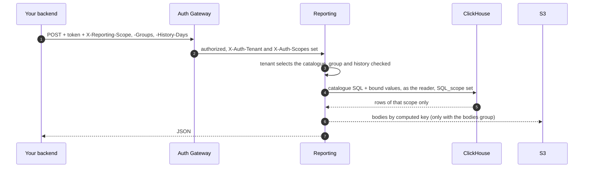

# Reporting

## Overview

Reporting is the read side of the events AuditFlow's sinks stored: metrics, event lists and traces from ClickHouse, and archived bodies from S3. A tenant's backend calls it on behalf of one of its customers, and each customer sees its own rows only. AuditFlow itself keeps no database and has no query API, by design: this module is where reads belong.

> **Status: alpha.** The contract can still change. Browsers and customers never reach this service directly; the backend that authenticated them does.

## Why Reporting?

AuditFlow routes events and owns no database, by design. Once the events sit in ClickHouse and S3, every product needs the same thing on top: show each customer its own numbers, safely. Handing customers SQL makes the schema a public contract at unbounded cost, and a new endpoint per chart never ends.

1. **A metric is a reviewed definition.** A catalogue names the table, the aggregation, the dimensions and the filters. Adding a metric adds a catalogue entry, not an endpoint.
2. **A request never becomes SQL.** It picks names from the catalogue, and every value is a bound parameter.
3. **Isolation is enforced twice.** Every query filters on the caller's scope, and a row policy on the server applies the same scope to a query that forgot.

**A good fit if**

- You already store events in ClickHouse, with or without AuditFlow, and several customers share a table.
- Your backend authenticates the customer and can say what its plan allows.

**Probably not what you need if**

- You want a BI tool for your own staff: Grafana or Athena on the same stores serves that better.
- You need dashboards, schedules or exports out of the box: this is the API under them.

## Capabilities

| Capability | Description |
|------------|-------------|
| **Metric catalogue** | One YAML file per tenant, validated at start. A metric is a reviewed definition: adding one adds a catalogue entry, not an endpoint. |
| **No client SQL** | A request picks names from the catalogue. Every value is a bound parameter. |
| **Two-layer isolation** | Every query filters on the caller's scope, and a ClickHouse row policy applies the same scope to a query that forgot. |
| **Groups and history** | The backend translates a plan into groups and days of history. The service knows no plan names. |
| **Events and traces** | Events paged by cursor, newest first, and every event of one correlation ID. |
| **Bodies from S3** | An event's archived request and response, read by a key computed from its row. Optional, limited to a group. |

## Features

- **Originals from S3**: an event's archived original, read from the object whose key its row holds (or found by a key computed from the row), minus the fields the catalogue excludes. Optional, can be limited to a group you name, and every read leaves a log line and a `reporting.body.access` count.
- **Groups and history**: your backend translates a plan into `X-Reporting-Groups` and `X-Reporting-History-Days`. This service knows no plan names; a catalogue's `maxHistoryDays` caps what a backend asserts.
- **Bounded**: query limits sit on the ClickHouse user, and a store that does not answer gives a `503` with `Retry-After`.
- **OpenAPI-first**: the [contract](https://github.com/Labs64/labs64.io-reporting/blob/master/src/main/resources/openapi/openapi-reporting-v1.yaml) generates the server interfaces and the gateway policies.
- **Observable**: Actuator health, Prometheus metrics (`reporting.operation`, per operation and tenant, never per customer) and OTLP traces.

## Architecture



## Caller contract

| Value | From | Rule |
|---|---|---|
| Tenant | `X-Auth-Tenant`, set by the gateway from the token | Selects the catalogue; none is a `403` |
| Delegation | `X-Auth-Scopes` must hold `reporting:read-delegated` | Give this role to your backend alone; otherwise `403` |
| Scope | `X-Reporting-Scope` | Required, `^[A-Za-z0-9_.:-]{1,128}$`, otherwise `400` |
| Groups | `X-Reporting-Groups` | Comma list; a metric outside it is a `403` |
| History | `X-Reporting-History-Days` | Limits how far back a caller reads, unless a metric says `fullHistory` |

## API

Every operation is `POST`, so it passes a public edge that only lets `POST` through to a backend's listed paths. Behind the gateway the paths start with `/reporting/api/v1`.

| Operation | Purpose |
|---|---|
| `/metrics/list` | The metrics this caller may see |
| `/metrics/query` | A series: range, interval, up to two dimensions, filters |
| `/events/search`, `/events/get` | Events, cursor paged; one event |
| `/traces/get` | Every event of one correlation ID |
| `/events/body` | An event's archived bodies |
| `/status` | How fresh the data is |

A store that does not answer gives a `503` with `Retry-After`; bodies past their retention give a `404`.

## Try it in two minutes

Docker only. This starts the service next to a ClickHouse with a small demo tenant:

```bash
docker compose -f docker-compose.images.yml up -d --wait
```

There is no gateway here, so you send the headers one would set. Ask for the same metric as two customers:

```bash
report() {
  curl -s localhost:8080/metrics/query -H 'Content-Type: application/json' \
    -H 'X-Auth-User: service:demo' -H 'X-Auth-Tenant: demo' -H 'X-Auth-Scopes: reporting:read-delegated' \
    -H 'X-Request-ID: demo' -H "X-Reporting-Scope: $1" -H 'X-Reporting-Groups: base' \
    -d '{"metric":"calls","from":"2020-01-01T00:00:00Z","to":"2100-01-01T00:00:00Z","interval":"none"}'
}
report acme     # value 3
report globex   # value 1
```

**On Kubernetes:**

```bash
helm repo add labs64io https://labs64.github.io/labs64.io-helm-charts
helm install reporting labs64io/reporting
```

Mount your catalogues at `/etc/labs64/reporting/catalogue` (values `volumes`, `volumeMounts`) and put a reader's password in `secrets.data.CLICKHOUSE_PASSWORD`. The [chart README](https://github.com/Labs64/labs64.io-helm-charts/tree/master/charts/reporting) lists every value.

**From source** (JDK 25, Maven): `mvn -B verify`. The integration test starts a real ClickHouse and skips itself when no Docker runs.

## The catalogue

One file per tenant, `<directory>/<tenant>.yaml`. The tenant comes from the gateway's token, so a request can't name another one. A working example is [`examples/demo/catalogue/demo.yaml`](https://github.com/Labs64/labs64.io-reporting/blob/master/examples/demo/catalogue/demo.yaml); the keys are described in [`AGENTS.md`](https://github.com/Labs64/labs64.io-reporting/blob/master/AGENTS.md#catalogue).

```yaml
database: demo
metrics:
  calls:
    description: Calls per day
    group: base             # the caller must hold this group
    table: calls
    scopeColumn: customer   # whose row is it
    time: event_time
    value: count()
    dimensions: {action: action}
    filters: {action: action}
```

| Setting | Meaning |
|---|---|
| `REPORTING_CATALOGUE_DIRECTORY` | Where `<tenant>.yaml` files are mounted |
| `CLICKHOUSE_URL`, `CLICKHOUSE_USERNAME`, `CLICKHOUSE_PASSWORD` | The reader user |
| `REPORTING_BODIES_BUCKET`, `AWS_REGION` | The archive; empty means no bodies |
| `REPORTING_ROW_POLICY_CHECK` | `strict` (default): a table readable without a row policy fails readiness. `warn`: it is only logged and counted |
| `REPORTING_ROW_POLICY_RECHECK` | How often that check repeats after the start; default `PT5M` |

## Deploying

Install the `reporting` chart. You bring:

1. **A ClickHouse** with a reader user: a settings profile with `readonly = 2` and query limits, `SELECT` on the tables a catalogue names, and a row policy `USING <scope column> = getSetting('SQL_scope')` on each. The umbrella chart can run one node (`clickhouse.enabled`).
2. **A catalogue per tenant**, mounted at `/etc/labs64/reporting/catalogue/<tenant>.yaml`. A tenant with no file gets a `403`.
3. **The reader's password** as `CLICKHOUSE_PASSWORD`.
4. Optionally **S3 read access** to one prefix, and `REPORTING_BODIES_BUCKET`.

## Before you go to production

- **Put it behind the Auth Gateway.** The service trusts the `X-Auth-*` headers it receives. Only a caller with `reporting:read-delegated` may name a scope, so give that role to your backend alone.
- **Give the reader a row policy on every table it can read.** `readonly = 2` and `SQL_scope` make it work. The service proves it at the start and every few minutes by asking each catalogue table for a scope nobody has: a row back fails readiness, for every tenant of the pod, and names the table. An empty table can't be proven until it holds rows.
- **Limit the reader in ClickHouse.** Execution time, result rows and memory belong in its settings profile. The service caps no range or bucket count: the result-row limit measures what a query really returns, and answers a `400`.
- **Close the way around the gateway.** The chart's `networkPolicy.enabled` is off by default; turn it on.

## Limits

The row policy protects against bugs in this service, not against code running inside it: the reader may change `SQL_scope`, so a compromised pod can set any scope. Schedules, exports, alerts and further query backends are not part of it yet.
