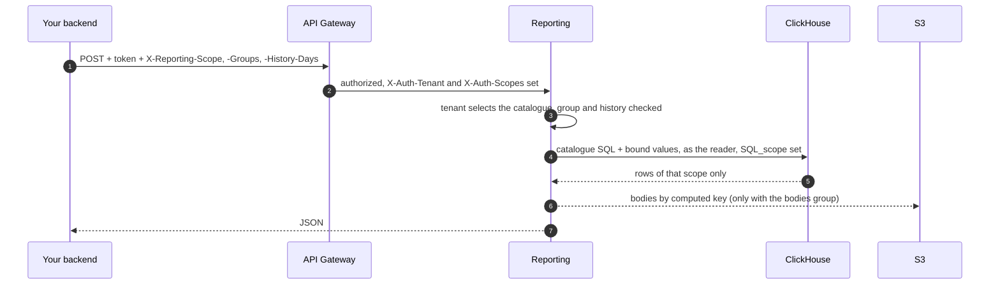

# Reporting

## Overview

Reporting is the read side of the events AuditFlow's sinks stored: metrics, event lists and traces from ClickHouse, and archived bodies from S3. A tenant's backend calls it on behalf of one of its customers, and each customer sees its own rows only. AuditFlow itself keeps no database and has no query API, by design: this module is where reads belong.

> **Status: alpha.** The contract can still change. Browsers and customers never reach this service directly; the backend that authenticated them does.

## Capabilities

| Capability | Description |
|------------|-------------|
| **Metric catalogue** | One YAML file per tenant, validated at start. A metric is a reviewed definition: adding one adds a catalogue entry, not an endpoint. |
| **No client SQL** | A request picks names from the catalogue. Every value is a bound parameter. |
| **Two-layer isolation** | Every query filters on the caller's scope, and a ClickHouse row policy applies the same scope to a query that forgot. |
| **Groups and history** | The backend translates a plan into groups and days of history. The service knows no plan names. |
| **Events and traces** | Events paged by cursor, newest first, and every event of one correlation ID. |
| **Bodies from S3** | An event's archived request and response, read by a key computed from its row. Optional, limited to a group. |

## Architecture

## Caller contract

| Value | From | Rule |
|---|---|---|
| Tenant | `X-Auth-Tenant`, set by the gateway from the token | Selects the catalogue; none is a `403` |
| Delegation | `X-Auth-Scopes` must hold `reporting:read-delegated` | Give this role to your backend alone; otherwise `403` |
| Scope | `X-Reporting-Scope` | Required, `^[A-Za-z0-9_.:-]{1,128}$`, otherwise `400` |
| Groups | `X-Reporting-Groups` | Comma list; a metric outside it is a `403` |
| History | `X-Reporting-History-Days` | Limits how far back a caller reads, unless a metric says `fullHistory` |

## API

Every operation is `POST`, under `/reporting/api/v1`.

| Operation | Purpose |
|---|---|
| `/metrics/list` | The metrics this caller may see |
| `/metrics/query` | A series: range, interval, up to two dimensions, filters |
| `/events/search`, `/events/get` | Events, cursor paged; one event |
| `/traces/get` | Every event of one correlation ID |
| `/events/body` | An event's archived bodies |
| `/status` | How fresh the data is |

A store that does not answer gives a `503` with `Retry-After`; bodies past their retention give a `404`.

## Quick start

The [module README](https://github.com/Labs64/labs64.io-reporting#try-it-in-two-minutes) starts the service next to a ClickHouse with a demo tenant, with Docker only.

## Deploying

Install the `reporting` chart. You bring:

1. **A ClickHouse** with a reader user: a settings profile with `readonly = 2` and query limits, `SELECT` on the tables a catalogue names, and a row policy `USING <scope column> = getSetting('SQL_scope')` on each. The umbrella chart can run one node (`clickhouse.enabled`).
2. **A catalogue per tenant**, mounted at `/etc/labs64/reporting/catalogue/<tenant>.yaml`. A tenant with no file gets a `403`.
3. **The reader's password** as `CLICKHOUSE_PASSWORD`.
4. Optionally **S3 read access** to one prefix, and `REPORTING_BODIES_BUCKET`.

## Limits

The row policy protects against bugs in this service, not against code running inside it: the reader may change `SQL_scope`, so a compromised pod can set any scope. Schedules, exports, alerts and further query backends are not part of it yet.
