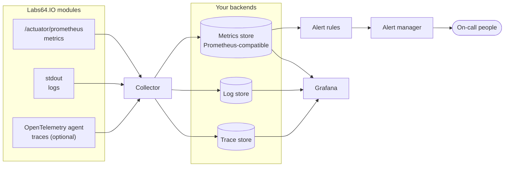
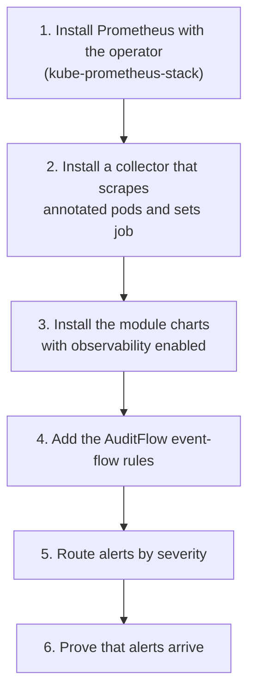
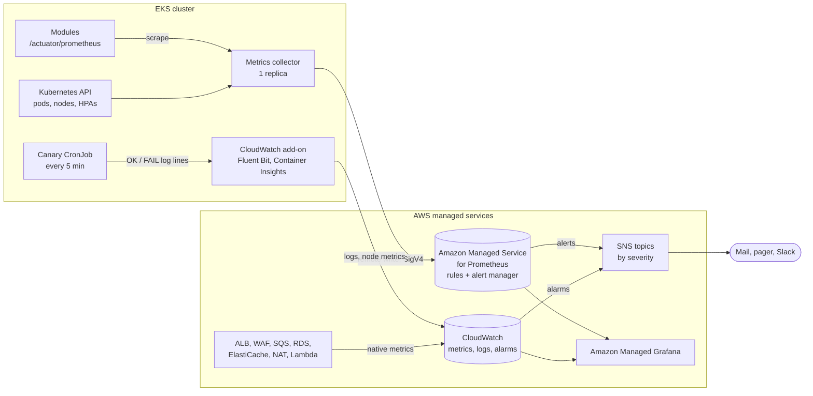
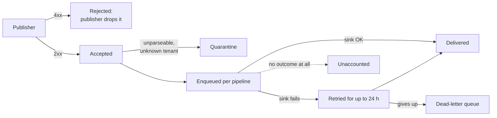
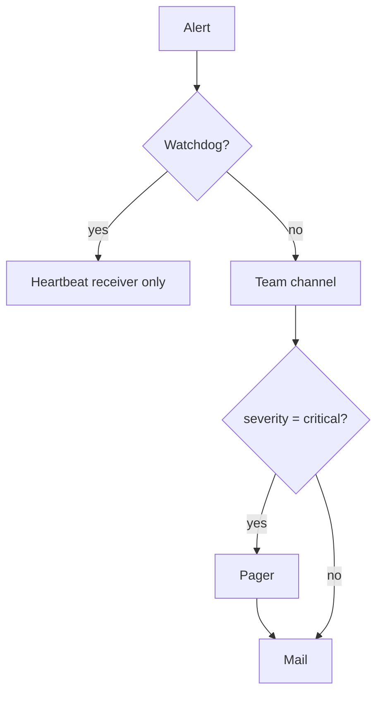

# Monitoring & Observability
{: .no_toc }

How Labs64.IO modules report their health, how to collect that in each way of running the platform, and which alerts tell you that a service is down or that audit events are not arriving.

<details open markdown="block">
  <summary>On this page</summary>
  {: .text-delta }
- TOC
{:toc}
</details>

## How it works

Monitoring is part of the deployment, not of the application. The modules contain no monitoring vendor's code. Each one publishes metrics on an HTTP endpoint and writes its logs to standard output. Tracing is switched on from outside, through environment variables the Helm chart sets. The same container image runs with monitoring on or off.



Three things are always true, whichever deployment you run:

| Rule | Why it matters |
|---|---|
| Metrics come from a scrape of `/actuator/prometheus` | Metric names never change when you turn tracing on or off, so dashboards and alerts keep working |
| A module's `job` label is `<namespace>/<module>`, for example `labs64io/auditflow` | The alert rules and dashboards the charts ship select modules by that label. Your collector must set it (see [Your Kubernetes cluster](#your-kubernetes-cluster)) |
| Alerts are evaluated next to the metrics, not in Grafana | Alerting keeps working when nobody has a dashboard open, and when Grafana is down |

## What the modules report

| Signal | Source | Always on | Examples |
|---|---|---|---|
| Request metrics | Every Java module, Micrometer | Yes | `http_server_requests_seconds_count`, `_bucket` (per `status`, `uri`) |
| Runtime metrics | Every Java module | Yes | `jvm_memory_used_bytes`, `process_start_time_seconds` |
| Event-flow metrics | AuditFlow | Yes | See the table below |
| Logs | Every container, JSON on stdout | Yes | Error lines, the request ID, the tenant |
| Traces | OpenTelemetry Java agent and Python auto-instrumentation | Only with `observability.enabled: true` | One trace from the gateway through AuditFlow to its sink |

AuditFlow reports what happens to every event, which is how you can tell whether events are lost:

| Metric | Counts | Labels |
|---|---|---|
| `auditflow_pipeline_outcomes_total` | Pipeline decisions per event; `outcome="ENQUEUED"` is one delivery queued for a sink | `tenant`, `pipeline`, `outcome` |
| `auditflow_delivery_outcomes_total` | Delivery attempts: `delivered`, `duplicate` (already delivered), failures | `tenant`, `pipeline`, `outcome` |
| `auditflow_delivery_deadlettered_total` | Deliveries given up after the retries and moved to the dead-letter queue | `tenant`, `pipeline`, `reason` |
| `auditflow_delivery_latency_seconds` | Time from first enqueue to delivery, retries included. Histogram buckets 1 s, 10 s, 1 min, 5 min, 15 min, 1 h, 3 h | `tenant`, `pipeline` |
| `auditflow_events_quarantined_total` | Events AuditFlow could not evaluate: unparseable, or for an unknown or disabled tenant | |
| `auditflow_tenant_ratelimit_fallback_total` | Rate-limit checks done per pod because the shared store was unreachable | |
| `auditflow_tenant_config_reload_errors_total` | Tenant documents that failed to load; the last valid one stays in use | |

## Choose your setup

| | Metrics | Logs | Traces | Dashboards | Alerts |
|---|---|---|---|---|---|
| [Quickstart](../getting-started/quickstart.md) | Not installed | `kubectl logs` | No | No | No |
| [One module locally](#one-module-with-docker-compose) | Prometheus | Loki | Tempo | Grafana, AuditFlow dashboard | No |
| [Full ecosystem locally](#full-ecosystem-on-a-local-cluster) | Prometheus | Loki | Tempo | Grafana, preloaded dashboards | No |
| [Your Kubernetes cluster](#your-kubernetes-cluster) | Your Prometheus | Your log store | Optional | Charts ship one per module | Charts ship the SLO rules; you add the rest |
| [AWS with managed services](#aws-with-managed-services) | Amazon Managed Service for Prometheus | CloudWatch Logs | Off by default | Amazon Managed Grafana | Prometheus rules and CloudWatch alarms |

The local setups are for seeing what the modules report. They keep data only as long as the containers live, and alert no one. Before you go live, follow one of the last two rows.

## One module with Docker Compose

AuditFlow's repository has an observability overlay: an OpenTelemetry Collector, Prometheus, Loki, Tempo and Grafana, next to the module.

```bash
just up obs
# or, without just:
docker compose -f docker-compose.yml -f docker-compose-observability.yml up --build -d
```

Grafana is at <http://localhost:3000> (`admin` / `admin`) with an AuditFlow dashboard already loaded. [AuditFlow deployment](../modules/auditflow/deployment/index.md) lists the other ports.

## Full ecosystem on a local cluster

From the workspace, `just up-otel` starts the local cluster with the monitoring stack and tracing switched on, then opens Grafana at `http://gateway.localhost/grafana/` (the command prints the password). It installs:

| Component | Role |
|---|---|
| OpenTelemetry Collector, one per node | Scrapes the modules' metrics, reads container logs, receives traces |
| Prometheus (kube-prometheus-stack) | Stores metrics and evaluates the charts' SLO rules |
| Loki | Stores logs |
| Tempo | Stores traces |
| Grafana | Dashboards: ecosystem overview, cluster, Traefik, authentication, JVM, AuditFlow, Checkout, the collector itself |

Alertmanager is not installed locally, so rules can fire but notify no one. Look at the **Alerts** page of Grafana or Prometheus instead.

## Your Kubernetes cluster

You run the monitoring stack, and the charts plug into it. The order below is what makes the shipped rules and dashboards work.



**1. Prometheus with the operator.** Install the Prometheus operator before the module charts, for example with kube-prometheus-stack. Each module chart renders its `PrometheusRule` only when the `monitoring.coreos.com/v1` API exists at install time. A module installed earlier needs a `helm upgrade` once the operator is in. Make Prometheus pick up rules from every release (`ruleSelectorNilUsesHelmValues: false` in kube-prometheus-stack), and enable Alertmanager.

**2. A collector.** It must:

- scrape pods annotated `prometheus.io/scrape: "true"`, at `prometheus.io/port` and `prometheus.io/path`;
- set `job` to `<namespace>/<app.kubernetes.io/name>` with a relabel rule, which the shipped rules depend on;
- for traces, accept OTLP on port 4318 of each node, since the charts point the agent at `http://$(NODE_IP):4318`.

The chart repository's `overrides/opentelemetry/values-collector.local.yaml` (labs64.io-helm-charts) does all three for the upstream `opentelemetry-collector` chart, running one collector per node. Point its exporters at your backends. A Prometheus `PodMonitor` with the same relabeling works for the metrics too.

**3. The module charts.** Set `observability.enabled: true` on every module. It adds the scrape annotations and, for traces, attaches the agent. Keep `slo.enabled: true` (the default) to get the SLO rules and a Grafana dashboard per module: a ConfigMap labelled `grafana_dashboard: "1"`, which the Grafana sidecar of kube-prometheus-stack loads.

| Chart value | Default | Effect |
|---|---|---|
| `observability.enabled` | `false` | Scrape annotations, the OpenTelemetry agent and its environment |
| `observability.otlpEndpoint` | `http://$(NODE_IP):4318` | Where traces and logs are sent |
| `slo.enabled` | `true` | `PrometheusRule` with the SLO rules, plus the dashboard ConfigMap |
| `slo.availability.targetRatio` | `0.999` | Share of requests without a 5xx |
| `slo.latency.targetRatio` | `0.99` | Share of requests faster than the threshold |
| `slo.latency.thresholdSeconds` | `0.5` | The latency threshold |

**4. AuditFlow event-flow rules.** The charts ship request SLOs only. Add [the rules below](#is-every-audit-event-delivered) to know whether events arrive.

**5. Route alerts by severity** ([below](#who-gets-which-alert)).

**6. Prove that alerts arrive** ([below](#make-sure-alerts-reach-someone)).

## AWS with managed services

On AWS you can avoid running Prometheus, Loki and Grafana yourself: each part of the stack has a managed service.



| Part | Service | Notes |
|---|---|---|
| Application metrics | Amazon Managed Service for Prometheus | The collector configuration is `overrides/opentelemetry/values-collector.aws.yaml` in labs64.io-helm-charts: one replica, metrics only, writing with SigV4 under an IAM role for its service account. Load the same rules as on your own cluster into the workspace's rule groups. |
| Cluster state (pods pending, node pressure, HPA at maximum) | The same collector, `k8s_cluster` receiver | A few series per pod and node. That is far cheaper than Container Insights' enhanced mode, whose control-plane records make up most of its log volume. |
| Logs | CloudWatch Logs, through the `amazon-cloudwatch-observability` add-on (Fluent Bit) | Give the log groups a retention before the add-on creates them, or they never expire. |
| AWS services | CloudWatch alarms | Load balancer 5xx and healthy targets, WAF blocks, queue depth and age, dead-letter queues, database connections, cache memory, NAT errors, certificate expiry. |
| Alert delivery | SNS | The Prometheus alert manager on AWS can only send to SNS; CloudWatch alarms send there too. Use one topic per severity ([below](#who-gets-which-alert)). For Slack, AWS Chatbot subscribes to a topic. |
| Dashboards | Amazon Managed Grafana | One workspace reads both the Prometheus workspace and CloudWatch, with sign-in through IAM Identity Center. Keep dashboards as JSON files and load them through the Grafana API, so a change in the UI is not the only copy. |
| Traces | Not collected by default | Tracing services bill per trace or span. Turn it on for an investigation, not permanently. |

## Service level objectives

Each module chart defines two objectives over 30 days:

- **Availability:** 99.9% of requests answered without a 5xx.
- **Latency:** 99% of requests answered within 0.5 s.

The rules alert on how fast the **error budget** is being spent, not on single bad minutes. The budget is the 0.1% (or 1%) of requests that may fail. An alert needs a long and a short window both above the same burn rate. The long window shows that the problem matters; the short one shows it is still going on, so the alert also resolves soon after the problem stops.

| Alert | Burn rate | Windows | Budget spent | Severity |
|---|---|---|---|---|
| `AvailabilityBudgetBurnFast`, `LatencyBudgetBurnFast` | 14.4× | 1 h and 5 min | 2% in an hour | critical |
| `AvailabilityBudgetBurnSlow` | 6× | 6 h and 30 min | 5% in six hours | critical |
| `LatencyBudgetBurnSlow` | 6× | 6 h and 30 min | 5% in six hours | warning |
| `AvailabilityBudgetBurnTicket` | 3× | 1 d and 2 h | 10% in a day | warning |

The rules also record the error ratio per window (`slo:availability:error_ratio_rate1h`, `slo:latency:slow_ratio_rate6h`, and so on). Chart those, so a dashboard and its alert always agree.

## Is every audit event delivered?

A request SLO says whether AuditFlow answers. It does not say whether events reach their sinks. These are the places an event can be lost, and what notices:



| Where | Alert on |
|---|---|
| Rejected at the door (400, 401, 403, 413) | More than 1% of publishes answered with that status |
| Quarantined | Any increase of `auditflow_events_quarantined_total` |
| A sink keeps failing | Under 90% of delivery attempts succeed for 15 minutes, per tenant and pipeline |
| Dead-lettered | Any new `auditflow_delivery_deadlettered_total`. On Amazon SQS, also the age of the oldest dead-letter message: SQS deletes it after 14 days |
| Late | Deliveries later than 5 minutes, as an objective: 99% within 5 minutes |
| Lost without an error | Deliveries enqueued 3 to 9 hours ago that were neither delivered nor dead-lettered |
| Nothing flows at all | A synthetic event published every few minutes that does not reach a sink |

These rules cover all of it except the synthetic event. Replace `labs64io` with your namespace:


```yaml
apiVersion: monitoring.coreos.com/v1
kind: PrometheusRule
metadata:
  name: auditflow-event-flow
  namespace: labs64io
spec:
  groups:
    - name: auditflow-event-flow
      rules:
        - alert: AuditFlowDeliveryFailing
          expr: |
            sum by (tenant, pipeline) (rate(auditflow_delivery_outcomes_total{job="labs64io/auditflow", outcome="delivered"}[15m]))
            / sum by (tenant, pipeline) (rate(auditflow_delivery_outcomes_total{job="labs64io/auditflow"}[15m])) < 0.9
          for: 15m
          labels: { severity: critical }
          annotations:
            summary: "Less than 90% of deliveries of {{ $labels.tenant }}/{{ $labels.pipeline }} succeed"
        - alert: AuditFlowDeadLettered
          # The counter starts at 1, so the second operand catches a series that is new.
          expr: |
            sum by (tenant, pipeline, reason) (increase(auditflow_delivery_deadlettered_total{job="labs64io/auditflow"}[10m])) > 0
            or sum by (tenant, pipeline, reason) (auditflow_delivery_deadlettered_total{job="labs64io/auditflow"}
                 unless auditflow_delivery_deadlettered_total{job="labs64io/auditflow"} offset 10m) > 0
          labels: { severity: critical }
          annotations:
            summary: "Deliveries of {{ $labels.tenant }}/{{ $labels.pipeline }} dead-lettered ({{ $labels.reason }})"
        - alert: AuditFlowQuarantined
          expr: sum(increase(auditflow_events_quarantined_total{job="labs64io/auditflow"}[10m])) > 0
          labels: { severity: warning }
          annotations:
            summary: "Events quarantined: unparseable, or the tenant is not routable"
        - alert: AuditFlowPublishRejected
          expr: |
            sum by (status) (rate(http_server_requests_seconds_count{job="labs64io/auditflow", uri=~"/audit/publish.*", status=~"4..", status!="429"}[10m]))
            / scalar(sum(rate(http_server_requests_seconds_count{job="labs64io/auditflow", uri=~"/audit/publish.*"}[10m]))) > 0.01
          for: 10m
          labels: { severity: warning }
          annotations:
            summary: "More than 1% of publishes answered {{ $labels.status }}: those events are dropped"
        # Freshness: 99% of deliveries within 5 minutes (bucket le="300.0"), as error-budget burn rates.
        - record: auditflow:delivery_late:ratio_rate5m
          expr: 1 - (sum(rate(auditflow_delivery_latency_seconds_bucket{job="labs64io/auditflow", le="300.0"}[5m])) / sum(rate(auditflow_delivery_latency_seconds_count{job="labs64io/auditflow"}[5m])))
        - record: auditflow:delivery_late:ratio_rate30m
          expr: 1 - (sum(rate(auditflow_delivery_latency_seconds_bucket{job="labs64io/auditflow", le="300.0"}[30m])) / sum(rate(auditflow_delivery_latency_seconds_count{job="labs64io/auditflow"}[30m])))
        - record: auditflow:delivery_late:ratio_rate1h
          expr: 1 - (sum(rate(auditflow_delivery_latency_seconds_bucket{job="labs64io/auditflow", le="300.0"}[1h])) / sum(rate(auditflow_delivery_latency_seconds_count{job="labs64io/auditflow"}[1h])))
        - record: auditflow:delivery_late:ratio_rate6h
          expr: 1 - (sum(rate(auditflow_delivery_latency_seconds_bucket{job="labs64io/auditflow", le="300.0"}[6h])) / sum(rate(auditflow_delivery_latency_seconds_count{job="labs64io/auditflow"}[6h])))
        - alert: AuditFlowFreshnessBudgetBurnFast
          expr: auditflow:delivery_late:ratio_rate1h > (14.4 * 0.01) and auditflow:delivery_late:ratio_rate5m > (14.4 * 0.01)
          for: 2m
          labels: { severity: critical }
          annotations:
            summary: "Deliveries later than 5 minutes spend the freshness budget 14.4x too fast"
        - alert: AuditFlowFreshnessBudgetBurnSlow
          expr: auditflow:delivery_late:ratio_rate6h > (6 * 0.01) and auditflow:delivery_late:ratio_rate30m > (6 * 0.01)
          for: 2m
          labels: { severity: warning }
          annotations:
            summary: "Deliveries later than 5 minutes spend the freshness budget 6x too fast"
        # Conservation: over six hours that ended three hours ago (retries run up to 3 h apart),
        # every enqueued delivery is delivered, a duplicate, or dead-lettered.
        - record: auditflow:deliveries_enqueued:increase6h_3h_ago
          expr: sum by (pipeline) (increase(auditflow_pipeline_outcomes_total{job="labs64io/auditflow", outcome="ENQUEUED"}[6h] offset 3h))
        - record: auditflow:deliveries_settled:increase6h_3h_ago
          expr: |
            sum by (pipeline) (increase(auditflow_delivery_outcomes_total{job="labs64io/auditflow", outcome=~"delivered|duplicate"}[6h] offset 3h))
            + (sum by (pipeline) (increase(auditflow_delivery_deadlettered_total{job="labs64io/auditflow"}[6h] offset 3h))
               or 0 * sum by (pipeline) (increase(auditflow_delivery_outcomes_total{job="labs64io/auditflow"}[6h] offset 3h)))
        - alert: AuditFlowDeliveriesUnaccounted
          expr: |
            (auditflow:deliveries_enqueued:increase6h_3h_ago - auditflow:deliveries_settled:increase6h_3h_ago) > 10
            and (auditflow:deliveries_enqueued:increase6h_3h_ago - auditflow:deliveries_settled:increase6h_3h_ago)
                / auditflow:deliveries_enqueued:increase6h_3h_ago > 0.02
          for: 30m
          labels: { severity: warning }
          annotations:
            summary: "Pipeline {{ $labels.pipeline }}: deliveries neither delivered nor dead-lettered"
```


The counters of the conservation check drift by a fraction of a percent at the window's edges, hence the 2% and 10-delivery thresholds.

**Events lost before AuditFlow** are invisible to it: a browser that never sends, or a publisher that gives up while AuditFlow is down. Count failed publishes in the publisher and alert there.

## Cluster health

Alert on these whatever your setup. kube-prometheus-stack ships comparable rules (`KubePodNotReady`, `KubeNodePressure`, `KubeHpaMaxedOut`); on AWS, the collector's `k8s_cluster` receiver provides the series for the first three.

| Alert | Fires when | Severity |
|---|---|---|
| Pods pending | A pod has been `Pending` for 30 minutes | warning |
| Node under pressure | A node reports memory, disk or PID pressure for 10 minutes; pods are being evicted | warning |
| Module at maximum replicas | An HPA has been at its maximum for 15 minutes and cannot scale out | warning |
| Container restarting | `process_start_time_seconds` changed more than once in 30 minutes | warning |
| Metrics missing | No scrape of a module for 15 minutes (`absent(up{job="labs64io/<module>"} == 1)`) | warning |

## Who gets which alert

Give every rule a `severity` label, and route on it:

| Severity | Means | Send to |
|---|---|---|
| `critical` | Events are being lost, or a service is down for its users | Someone who will wake up: a pager or phone, plus the team channel |
| `warning` | Something will become a problem, or needs a look today | Team channel and mail |



Group by `alertname` and `job`, and repeat an unresolved alert every few hours rather than every few minutes. **Watch one event in one place:** if a CloudWatch alarm already watches a dead-letter queue, don't add a Prometheus alert on the same events. Otherwise every incident arrives twice, and people learn to ignore both.

If an environment is switched off at night to save cost, mute its alerts for that window (Alertmanager `mute_time_intervals`), or every night pages someone.

## Make sure alerts reach someone

A rule that fires into a mailbox no one reads, or through an alert manager that has stopped, protects nothing. Three checks close that gap:

| Check | How |
|---|---|
| **Synthetic event** | A CronJob gets a token and publishes one event through the public endpoint every 5 minutes. Alert when it fails or stops running, and when its events stop reaching a sink. This covers the gateway, identity provider, AuditFlow and the sinks, end to end. |
| **Dead man's switch** | An alert that always fires (`expr: vector(1)`, named `Watchdog`), routed every 10 minutes to an external heartbeat service. When the pings stop, that service alerts from outside your infrastructure. It is the only alert that still works when the alert manager, the notification service or the cloud account is broken. |
| **Alarm drill** | Before go-live, after changing alert routing, and twice a year: make one warning and one critical alert fire, and check that each arrives where it should. Nothing else proves that a subscription is confirmed and that a mail filter doesn't swallow it. |

## Dashboards to have

| Dashboard | Shows |
|---|---|
| Overview | Firing alerts, SLOs and error-budget burn per module, request rate and latency |
| AuditFlow event flow | Accepted, rejected, delivered, dead-lettered, quarantined and unaccounted events; delivery delay (p50, p95, share within 5 minutes); the synthetic event; sink circuit breakers |
| Gateway | Request rate, latency and status codes per route |
| Brokers and queues | Depth and age of the oldest message; dead-letter depth and age |
| Data stores | Connections, memory, CPU, backup status |
| Cluster | Nodes, pods pending, restarts, HPA replicas |

The charts' per-module dashboards cover the request part of the overview. Build the rest from the recorded series (`slo:*`, `auditflow:*`), so a panel shows exactly what its alert evaluates.

## Before you go live

- [ ] Metrics from every module arrive with `job="<namespace>/<module>"`, and the SLO rules are loaded.
- [ ] The AuditFlow event-flow rules are loaded, with severities.
- [ ] Critical alerts reach a person out of hours, and warnings reach the team.
- [ ] The synthetic event runs, and the dead man's switch is green at the heartbeat service.
- [ ] An alarm drill has been run, and every alert it raised arrived.
- [ ] Logs have a retention, and dashboards that show tenant data are restricted to the people allowed to see it.

Correlate an incident with `X-Request-ID` and the tenant. Keep dashboards that everyone can see free of event content: they show counts, not payloads.
