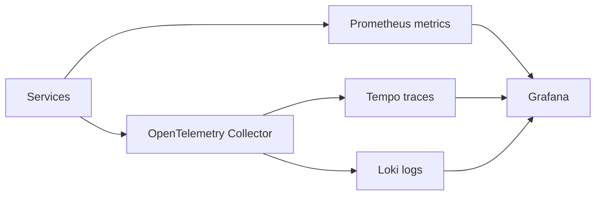

# Monitoring & Observability

Operate the platform with correlated metrics, logs, and traces. The deployment supplies telemetry collection so services can use a consistent pipeline.

## What to monitor

| Signal | Questions it answers | Alert examples |
|---|---|---|
| Availability | Can callers reach the service? | Failed health checks, high 5xx rate |
| Latency | Is a user flow slowing down? | Sustained high p95/p99 latency |
| Saturation | Is capacity close to a limit? | CPU, memory, connection, or queue thresholds |
| Event flow | Are events being processed and delivered? | Queue growth, sink failures, processing lag |
| Security edge | Are requests unexpectedly denied or failing validation? | Auth failures, policy denials, webhook verification failures |

## Minimum dashboard set

1. Gateway request rate, latency, and status codes.
2. One service-health view per deployed service.
3. Broker queue depth and consumer health for event-driven flows (RabbitMQ queues, or the SQS queues' visible messages), plus the age of the oldest DLQ entry on SQS, which deletes messages after 14 days.
4. Database health, connections, and backup status for each stateful service.
5. Sink delivery success and lag for AuditFlow pipelines.

## Alert rules the charts ship

With `slo.enabled` (the default) and the Prometheus operator's `PrometheusRule` CRD installed, every module
chart renders its SLO rules: 99.9% of requests without a 5xx and 99% within 0.5 s (`slo.availability`,
`slo.latency`), alerted as **error-budget burn rates** over 30 days. An alert fires when a long and a short
window both burn the budget faster than a factor: `…BudgetBurnFast` (14.4×: 2% of the budget in an hour,
severity `critical`), `…BudgetBurnSlow` (6×: 5% in six hours) and `AvailabilityBudgetBurnTicket` (3×: 10% in a
day, `warning`). A single bad minute does not page; an outage does within minutes. The recorded series
(`slo:availability:error_ratio_rate<window>`, `slo:latency:slow_ratio_rate<window>`) chart the burn on a
dashboard.

For AuditFlow, two more signals tell you whether events arrive, not just whether the API answers:

| Signal | Metric | Alert on |
|---|---|---|
| Delivery freshness | `auditflow_delivery_latency_seconds` (enqueued to delivered, retries included; buckets 1 s … 3 h) | The share within 5 minutes, `bucket{le="300.0"}` / `count`, burning a 99% target |
| Nothing lost silently | `auditflow_pipeline_outcomes_total{outcome="ENQUEUED"}` against `auditflow_delivery_outcomes_total{outcome=~"delivered\|duplicate"}` plus `auditflow_delivery_deadlettered_total`, per pipeline | A gap over a few hours that ended a few hours ago (retries run up to 3 h) |

Use `X-Request-ID` and the trusted tenant context carefully to correlate an incident without exposing sensitive data in broad-access dashboards.
